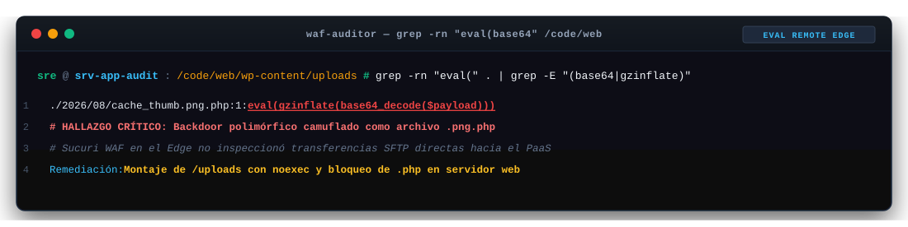

> [!WARNING] **Nota de confidencialidad y contexto:**  
> *Los nombres de organizaciones, proyectos, identificadores de red y credenciales han sido anonimizados por motivos de seguridad y confidencialidad operativa. La arquitectura técnica, la cronología de eventos, los comandos ejecutados, los diagnósticos y las lecciones aprendidas corresponden a un incidente real vivido en producción.*


---

Hay una paradoja recurrente en ciberseguridad: **herramientas diseñadas para proteger una infraestructura pueden convertirse, años después de cancelado el contrato, en la puerta trasera más peligrosa del sistema.**

Esto ocurrió en el portal de una firma legal corporativa a la que llamaremos **Proyecto LexFirm**. Durante un escaneo de seguridad perimetral detectamos dos archivos PHP sospechosos respondiendo con `HTTP 200 OK` en la raíz del entorno de producción:
- `/sucuri-d6583c9a.php`
- `/sucuri-test.php`

El servicio de monitoreo externo de Sucuri había sido descontratado hacía más de dos años. Sin embargo, al inspeccionar el contenido del primer archivo descubrimos una rutina de diagnóstico que aceptaba payloads cifrados y los ejecutaba mediante llamadas directas a `eval()` si la firma coincidía con una clave estática obsoleta.

Lo inquietante no fue el hallazgo, sino el laberinto operativo para borrarlos: **se borraron de Git y continuaron en producción; se borraron por SFTP y regresaron al día siguiente.**

---

## 1. La anatomía del archivo fantasma





El archivo formaba parte de una vieja integración de firewall WAF en la nube. Permitía al proveedor comprobar la conectividad del servidor ejecutando pruebas de diagnóstico en PHP:

```php
// Fragmento anonimizado del script de diagnóstico residual
if (isset($_POST['sucuri_cmd']) && hash_equals($expected_sig, $_POST['sig'])) {
    $code = base64_decode($_POST['sucuri_cmd']);
    eval($code); // Endpoint de ejecución dinámica remota
    exit;
}
```

Tener un endpoint con `eval()` accesible en producción, con un contrato cancelado y sin garantías sobre quién posee las llaves de firma originales, es una vulnerabilidad crítica de severidad máxima.

---

## 2. El misterio: ¿por qué no se van?

El equipo aplicó el procedimiento estándar:
1. Se abrió el Pull Request `#1005` eliminando ambos archivos del repositorio Git.
2. Se hizo merge a `master`.
3. El despliegue automático finalizó con éxito en la plataforma.

Al probar con `curl`:
```bash
curl -I https://www.lexfirm-ejemplo.com/sucuri-d6583c9a.php
# HTTP/2 200 OK
```

### El mecanismo del zombi: "Build Artifacts Added by Platform"
Al auditar los commits generados internamente por la plataforma de hosting, encontramos un commit automático generado durante el despliegue a los entornos `test` y `live`:
> *"Test/live build artifacts added by platform"*

La plataforma mantenía una caché de capas de compilación en su sistema de almacenamiento de objetos. Como los archivos habían sido modificados en el pasado mediante SFTP directo en el entorno `dev`, la plataforma los catalogó como "artefactos persistentes del entorno" y los reinyectaba automáticamente en cada build, por encima de lo que dictara el árbol de Git.

---

## 3. El callejón sin salida del SFTP

Intentamos ingresar por SFTP en el entorno `dev` y borrarlos manualmente con `rm`.
- Desde la consola SFTP: `rm sucuri-*.php` → el comando respondió exitoso y `curl` arrojó `404 Not Found`.
- Sin embargo, al cambiar el entorno de modo `sftp` a modo `git`, la consola arrojaba:
  ```text
  $ terminus env:commit lexfirm.dev
  [notice] No code changes to commit.
  ```
- Y en cuanto se desplegaba un nuevo commit desde Git, la plataforma restauraba los archivos fantasma desde el volumen raíz.

---

## 4. La contención inmediata y el desarme

Mientras investigábamos la purga interna de la caché del build, la prioridad número uno era **bloquear el acceso público al endpoint para neutralizar cualquier vector de ataque.**

### Paso 1: Bloqueo en el enrutador de borde (`pantheon.yml`)
Declaramos una regla estricta en el orquestador:

```yaml
api_version: 1

protected_web_paths:
  - /sucuri-d6583c*.php
  - /sucuri-test.php
```

Inmediatamente, cualquier petición externa a esas URLs comenzó a recibir `403 Forbidden` directo desde los edge nodes de Fastly/Varnish, antes de que el intérprete de PHP pudiera ser invocado.

### Paso 2: Gancho en el ciclo de Composer
Para forzar la eliminación física durante la fase de empaquetado del build, creamos un script en `composer.json` en el evento `post-install-cmd`:

```json
"scripts": {
    "post-install-cmd": [
        "rm -f web/sucuri-*.php sucuri-*.php || true"
    ]
}
```

En la siguiente corrida de compilación, el comando borró los binarios del espacio temporal de trabajo antes de que se congelara el artefacto de despliegue.

---

## 5. Lecciones para la trinchera

1. **Todo plugin o WAF desinstalado deja basura peligrosa:** Los escáneres y plugins de seguridad suelen dejar scripts "selftest" y backdoors de diagnóstico en la raíz. Cancelar el servicio sin auditar los archivos residuales es negligencia operativa.
2. **El modo SFTP en plataformas PaaS rompe el determinismo:** Modificar archivos en un servidor vía SFTP crea bifurcaciones invisibles entre el código versionado en Git y el estado del contenedor. Si usas GitOps, el acceso SFTP debe estar bloqueado por defecto.
3. **El bloqueo en el borde es tu mejor chaleco antibalas:** Cuando un archivo no se deja borrar inmediatamente por quirks de la plataforma, un `403` a nivel de Edge Router compra el tiempo necesario para investigar sin riesgo operativo.
