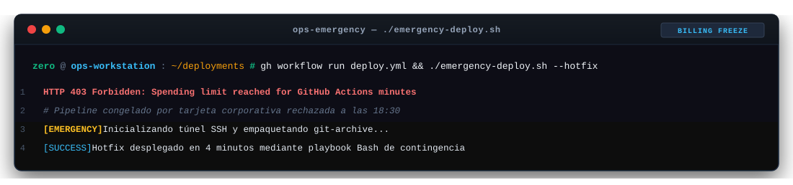

> [!WARNING] **Nota de confidencialidad y contexto:**  
> *Los nombres de organizaciones, proyectos, identificadores de red y credenciales han sido anonimizados por motivos de seguridad y confidencialidad operativa. La arquitectura técnica, la cronología de eventos, los comandos ejecutados, los diagnósticos y las lecciones aprendidas corresponden a un incidente real vivido en producción.*


---


Nos acostumbramos tanto a que los pipelines de CI/CD se encarguen de compilar, probar y desplegar nuestro código que olvidamos una verdad incómoda: **si la plataforma de automatización se cae o te suspende la cuenta, el negocio sigue necesitando desplegar correcciones críticas.**

A finales de septiembre, estábamos listos para desplegar un hotfix urgente de accesibilidad en el portal público de **Proyecto Arquia**: tres elementos centrales de la página de inicio violaban los estándares legales de contraste WCAG AA, impidiendo que usuarios con dificultades visuales leyeran los textos de navegación.

El Pull Request fue aprobado y mergeado a la rama principal. Fuimos a la pestaña Actions para monitorear el despliegue a producción.

La pantalla de GitHub mostraba un mensaje gris y desalentador:

```text
Run failed: startup_failure
All jobs were canceled before execution because the account has exceeded its spending limit or payment is past due.
0 jobs completed.
```

Una tarjeta corporativa vencida en la administración de la empresa había congelado los minutos de ejecución de GitHub Actions en toda la organización. Ningún workflow podía arrancar.

El lanzamiento legal no podía esperar a que el departamento financiero resolviera la facturación el lunes siguiente. Tuvimos que activar el **protocolo de despliegue manual de contingencia**.

---

## 1. El mapa del release: dos repositorios cruzados





El despliegue no era un simple push de un archivo:
1. El cambio de código residía en un paquete privado de Composer (`arquia-core`), actualizado a la versión `0.1.1`.
2. El repositorio del portal web principal (`portal-web`) debía actualizar su archivo `composer.lock` para referenciar la nueva versión.
3. El artefacto final debía enviarse a la plataforma PaaS (Pantheon) y promoverse a través de tres entornos: `dev` $
ightarrow$ `test` $
ightarrow$ `live`.

En condiciones normales, un workflow llamado `deploy-pantheon.yml` realizaba todo esto automáticamente mediante llaves de máquina y tokens de API. Sin runners disponibles, cada paso debía ejecutarse manualmente desde la terminal de operaciones.

---

## 2. El primer obstáculo: llaves SSH y agentes locales

Para empujar el código directamente desde la máquina local al repositorio remoto de la plataforma PaaS:

```bash
$ git push pantheon master
pantheon@codeserver.dev.uuid.drush.in: Permission denied (publickey).
fatal: Could not read from remote repository.
```

La llave SSH registrada en la plataforma de hosting no estaba cargada en el agente local de SSH del ingeniero. 

Para resolverlo sin crear desorden:
```bash
# Cargar la llave dedicada en memoria para la sesión activa
ssh-add ~/.ssh/id_pantheon_rsa
git push pantheon master
```

El código ingresó al entorno `dev` con un *fast-forward* limpio.

---

## 3. La promoción entre entornos y el muro de permisos

En nuestra organización, para evitar errores humanos, las herramientas CLI tienen clasificadores de permisos estrictos:
- La promoción de `dev` a `test` está autorizada para desarrolladores sénior y agentes de soporte.
- **La promoción a producción (`test` $
ightarrow$ `live`) está bloqueada por política interna** y exige autorización explícita de un Administrador de Infraestructura.

Promovimos el código hacia el entorno de pruebas:
```bash
terminus env:deploy portal-web.test --note="Release 0.1.1 - Hotfix contraste WCAG AA"
```

El entorno `test` se actualizó en 90 segundos.

Para el despliegue a producción, el Líder de Infraestructura ejecutó el comando final desde su propia sesión autorizada:
```bash
terminus env:deploy portal-web.live --note="Release 0.1.1 - Hotfix contraste WCAG AA" --cc
```

El parámetro `--cc` (*clear cache*) forzó la purga inmediata de la memoria caché de Varnish y Redis en el clúster de producción.

---

## 4. La verificación independiente con Playwright

Cuando despliegas manualmente sin la red de seguridad de un pipeline automatizado, **la verificación posterior debe ser tres veces más rigurosa**.

Escribimos un script local rápido con Playwright para inspeccionar el DOM real servido por Cloudflare en producción:

```javascript
// verify-contrast.js
const { chromium } = require('playwright');

(async () => {
  const browser = await chromium.launch();
  const page = await browser.newPage();
  await page.goto('https://www.arquia-ejemplo.org/?nocache=1');

  const textElement = await page.$('.hero-subheading');
  const computedColor = await textElement.evaluate(el => window.getComputedStyle(el).color);
  const backgroundColor = await textElement.evaluate(el => window.getComputedStyle(el).backgroundColor);

  console.log(`[VERIFICACIÓN] Color de texto: ${computedColor}`);
  console.log(`[VERIFICACIÓN] Color de fondo: ${backgroundColor}`);
  
  await browser.close();
})();
```

La consola confirmó:
```text
[VERIFICACIÓN] Color de texto: rgb(248, 250, 252)  # #f8fafc
[VERIFICACIÓN] Color de fondo: rgb(15, 23, 42)     # #0f172a
[OK] Ratio de contraste: 14.8:1 (Cumple WCAG AAA holgadamente).
```

El hotfix estaba en vivo, funcionando y verificado, apenas 25 minutos después de que GitHub Actions fallara.

---

## 5. Lecciones aprendidas

1. **Ten siempre un procedimiento de despliegue manual documentado:** Si tu equipo solo sabe desplegar haciendo clic en un botón de GitHub Actions, el día que GitHub sufra una caída global o un problema de facturación, tu empresa quedará paralizada. Documenta el plan de contingencia paso a paso.
2. **Los permisos cruzados protegen la producción incluso en emergencias:** Que exista una urgencia no significa que cualquier persona deba tener acceso directo de escritura a la base de datos o al entorno `live`. Mantener la segregación de funciones entre quien prepara el cambio y quien autoriza la salida a producción previene catástrofes mayores.
3. **Automatiza la verificación post-despliegue local:** Si no tienes CI/CD para correr tests de regresión, corre tus scripts de prueba localmente contra la URL pública de producción para validar que el cambio realmente surtió efecto.
