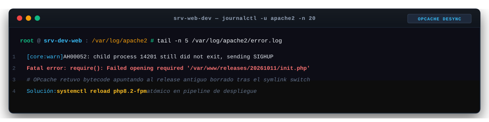

> [!WARNING] **Nota de confidencialidad y contexto:**  
> *Los nombres de organizaciones, proyectos, identificadores de red y credenciales han sido anonimizados por motivos de seguridad y confidencialidad operativa. La arquitectura técnica, la cronología de eventos, los comandos ejecutados, los diagnósticos y las lecciones aprendidas corresponden a un incidente real vivido en producción.*


---


En soporte de infraestructura es muy común recibir reportes binarios:  
*«La máquina de pruebas está caída, no carga nada»*.

Cuando me conecté al servidor de desarrollo de **Proyecto Horizonte** (`develop.horizonte-ong.org`), la realidad contradijo el reporte: una petición con `curl` devolvió un impecable `HTTP/2 200 OK` en apenas 120 milisegundos.

¿Falsa alarma? No exactamente. 

Al revisar los gráficos históricos de telemetría en Netdata, descubrimos que el servidor **había estado saturado al 100% de su capacidad durante casi 20 horas continuas**, recuperándose por sí solo minutos antes de la inspección. Tirando de ese hilo desenredamos una madeja de cuatro defectos de arquitectura que explicaban, además, por qué el sitio arrojaba errores 500 aleatorios después de cada despliegue.

---

## 1. La autopsia de la saturación en Netdata





El servidor corría en una máquina virtual con 4 GB de RAM bajo la arquitectura clásica de Apache:
- `mpm_prefork` + `mod_php` 8.2.
- `MaxRequestWorkers 12` (cada proceso worker consumía ~300 MB de memoria).
- Partición de Swap activa en disco.

Entre las 23:00 UTC del 29 de septiembre y las 19:00 UTC del 30 de septiembre:
- **10 de los 12 workers de Apache estuvieron ocupados de forma permanente.**
- El uso de Swap alcanzó el 85%, degradando drásticamente el rendimiento de lectura de disco.
- Cualquier visitante nuevo caía en la cola de espera de sockets hasta alcanzar el timeout del navegador.

Al auditar los procesos con `lsof` y `ss -tan`:
```bash
$ ss -tan state established '( dport = :https or sport = :https )'
# Múltiples conexiones en estado CLOSE_WAIT con timers de 300 segundos
```

### El primer culpable: `Timeout 300` en Apache
La directiva `Timeout` en `/etc/apache2/apache2.conf` estaba configurada en **300 segundos (5 minutos)**. Clientes con conexiones móviles inestables o escáneres de vulnerabilidades que abrían el handshake TLS y dejaban la conexión a medias retenían un proceso completo de Apache de 300 MB durante cinco minutos enteros antes de que el kernel pudiera liberarlo.

---

## 2. El segundo culpable: el tema que se atacaba a sí mismo

Al analizar los logs de acceso de Apache (`access.log`) descubrimos un patrón desconcertante: miles de peticiones hacia la ruta:

```text
GET /wp-content/themes/horizonte/timthumb.php?src=https://develop.horizonte-ong.org/uploads/2026/09/foto.jpg&w=400&h=300
```

Un script interno del tema institucional redimensionaba imágenes al vuelo durante el renderizado de la página. Para obtener la imagen original, **el servidor PHP realizaba una petición HTTP remota hacia su propio dominio público.**

Como el servidor tenía solo 12 workers:
- El Worker 1 recibía la petición de la página de inicio.
- Al renderizar el HTML, el Worker 1 abría 6 peticiones HTTP concurrentes contra sí mismo para redimensionar 6 imágenes.
- Esas 6 peticiones eran tomadas por los Workers 2, 3, 4, 5, 6 y 7.
- **Un solo usuario visitando la portada secuestraba más del 50% de la capacidad de todo el servidor.**

---

## 3. El misterio de los errores 500 post-despliegue: OPcache y Symlinks

Durante meses, el equipo había aceptado como "normal" que, tras ejecutar un despliegue de Git, el primer visitante se encontrara con un pantallazo blanco o un error HTTP 500 que desaparecía al recargar.

Al inspeccionar el script de despliegue atómico:

```bash
# atomic-deploy.sh
ln -sfn /srv/apps/releases/v2026-10-08 /srv/apps/current
# [!] Fin del script. Ningún comando posterior.
```

El script cambiaba el enlace simbólico `current` hacia la nueva versión del código, pero **nunca notificaba a Apache ni vaciaba la memoria de OPcache**.

### ¿Qué ocurre en la memoria de PHP?
PHP compila los archivos `.php` a bytecode y los almacena en memoria compartida (OPcache). Por defecto, `opcache.revalidate_path` está desactivado. Cuando el symlink cambia:
1. Algunos workers de Apache siguen ejecutando el bytecode de los archivos viejos en memoria.
2. Otros workers leen las nuevas clases en disco.
3. La colisión de firmas entre clases viejas y nuevas genera un error fatal:  
   *`Fatal error: Cannot declare class WP_Theme, because the name is already in use`*.

El error persistía hasta que el proceso de Apache moría por llegar a `MaxConnectionsPerChild` o un reinicio forzado.

---

## 4. La remediación integral

Implementamos una solución en cuatro frentes:

1. **Ajuste de timeouts en Apache:**
   Redujimos la directiva `Timeout` de 300 segundos a **15 segundos**, y fijamos `KeepAliveTimeout 2`. Las conexiones lentas o incompletas se liberan en milisegundos.
2. **Caché estática de miniaturas:**
   Reemplazamos el script de redimensionamiento dinámico por la generación nativa de tamaños de WordPress en el hook `after_setup_theme`, eliminando por completo las peticiones HTTP internas contra el propio host.
3. **Recarga atómica de OPcache en el deploy:**
   Modificamos el script de despliegue para invocar una recarga suave de Apache (*graceful reload*) inmediatamente después de actualizar el symlink:
   ```bash
   ln -sfn "$RELEASE_DIR" "$CURRENT_DIR"
   sudo systemctl reload apache2 # Limpia OPcache sin interrumpir conexiones activas
   ```
4. **Activación de WP Rocket:**
   Se configuró el plugin de caché en develop para servir páginas HTML estáticas cacheadas, reduciendo la carga de CPU de PHP en un 90%.

---

## 5. Lecciones aprendidas

1. **Un servidor que responde rápido puede estar al borde del colapso:** Verifica la utilización de recursos históricos en tus herramientas de telemetría (Netdata, Prometheus, Datadog) antes de dar por buena una queja de lentitud.
2. **Los symlinks de despliegue exigen invalidar OPcache:** Cambiar un enlace simbólico en disco es transparente para el sistema de archivos, pero invisible para la memoria compartida de PHP. Todo deploy atómico debe recargar el servidor web o invocar `opcache_reset()`.
3. **Nunca dejes que tu backend se haga peticiones HTTP a sí mismo:** Si un script de PHP necesita un recurso local (como una imagen para recortar), léelo directamente desde la ruta absoluta en disco (`/srv/apps/current/uploads/...`), jamás a través de la interfaz de red pública.
