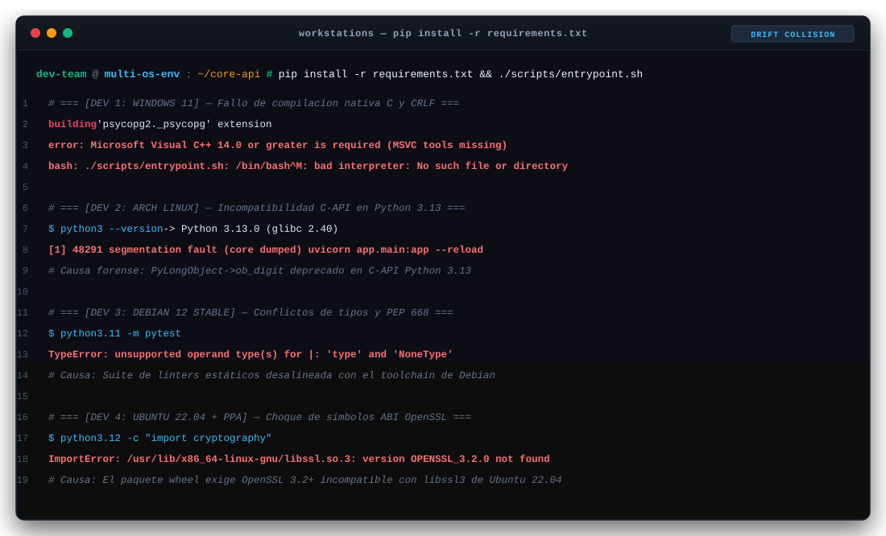
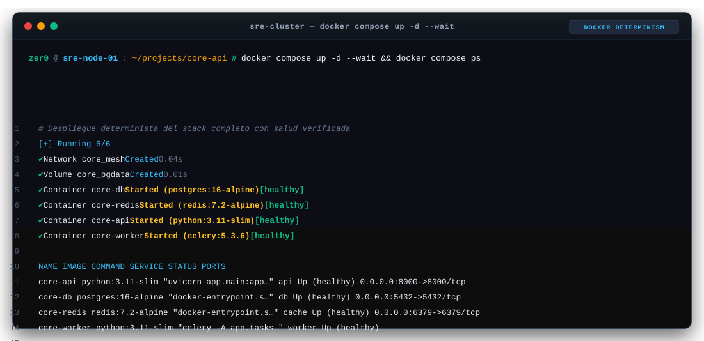

> [!WARNING] **Nota de contexto y trinchera técnica:**  
> *Los entornos virtuales a nivel de lenguaje (`venv`, `pyenv`, `nvm`) resuelven la versión del intérprete y sus librerías inmediatas, pero son completamente ciegos a las dependencias compartidas del sistema operativo (`glibc`, `OpenSSL`, `libpq`), a los compiladores nativos y a las particularidades del kernel anfitrión. Lo que sigue es la disección de un incidente real donde asumir paridad técnica en máquinas de desarrollo estuvo a punto de tumbar un despliegue crítico en producción.*

---

Hay frases en operaciones que deberían encender sirenas de alarma de inmediato. Una de las más peligrosas es:  
*«Tranquilos, ese servidor ya está congelado»*.  

Pero hay otra, aún más cotidiana, corrosiva y aceptada en los equipos de desarrollo:  
*«Clona el repositorio, activa el virtualenv y corre pip install. Debería funcionar a la primera»*.

**Nunca funciona a la primera.**

Detrás del clásico meme del *«en mi máquina sí funciona»* no hay una simple anécdota simpática de oficina: hay miles de horas de ingeniería perdidas, fricciones agrias entre equipos, onboarding de semanas que deberían tomar minutos y, en el peor de los casos, caídas catastróficas durante despliegues a producción un viernes por la tarde.

En este artículo quiero relatar la crónica de cómo una supuesta "pequeña divergencia de versiones" en un equipo de cuatro ingenieros paralizó un despliegue de emergencia, la autopsia técnica de por qué los entornos virtuales tradicionales no pudieron salvarnos y por qué los contenedores OCI estandarizados con Docker son el único contrato determinista que garantiza paz mental operativa.

---

## 1. El pecado original: la ilusión de la receta en el README

El escenario era un clásico de la industria: una pasarela de pagos y facturación electrónica basada en Python y FastAPI que procesaba transacciones en tiempo real. Ante una actualización normativa de emergencia emitida por la autoridad tributaria, necesitábamos incorporar a dos desarrolladores de apoyo para entregar un parche en menos de 48 horas.

El proyecto tenía un documento de incorporación en su `README.md` que parecía razonable:

```markdown
### Requisitos Previos
- Python 3.11+
- PostgreSQL y Redis corriendo localmente
- Ejecutar:
  $ python -m venv .venv
  $ source .venv/bin/activate
  $ pip install -r requirements.txt
  $ uvicorn app.main:app --reload
```

A las 14:00 del jueves, el equipo completo comenzó a clonar el repositorio. Lo que debía ser un setup de veinte minutos se convirtió en una espiral de frustración técnica que consumió casi un día y medio de trabajo. 

Cuatro desarrolladores intentaban levantar exactamente el mismo código base en cuatro sistemas operativos distintos. Y el código reaccionó como si estuviera en cuatro planetas diferentes.

---

## 2. La Torre de Babel: cuatro máquinas, cuatro universos paralelos

A continuación está la autopsia real de cómo falló cada estación de trabajo al ejecutar exactamente los mismos comandos del README:



```
+----------------------------------------------------------------------------------------------------+
|                                 LA MATRIZ DE LA DIVERGENCIA (BARE-METAL DRIFT)                     |
+----------------------------------------------------------------------------------------------------+
  DEV 1 (Windows 11)   → Python 3.11.4 · Win32 · CRLF · Falta MSVC 14.0 → ERROR: Fallo de compilación C
  DEV 2 (Arch Linux)   → Python 3.13.0 · glibc 2.40 · C-API Deprecada  → CRASH: Segfault en import
  DEV 3 (Debian 12)    → Python 3.11.2 · LTS Congelado · OpenSSL 3.0.13 → FAIL: Tipos no soportados
  DEV 4 (Ubuntu 22.04) → Python 3.12 (PPA deadsnakes) · Conflicto apt   → CONFLICT: libssl3 mismatch
  --------------------------------------------------------------------------------------------------
  PRODUCCIÓN / CI      → Debian 12 Minimal (OCI Container)              → RESULTADO: Fricción total
+----------------------------------------------------------------------------------------------------+
```

### Desarrollador 1: La pesadilla de Windows 11 y las extensiones C
El primer desarrollador utilizaba un portátil con Windows 11. Ejecutó `pip install -r requirements.txt` y a los dos minutos el terminal vomitó una pared roja de texto incomprensible:

```text
building 'psycopg2._psycopg' extension
error: Microsoft Visual C++ 14.0 or greater is required. 
Get it with "Microsoft C++ Build Tools": https://visualstudio.microsoft.com/visual-cpp-build-tools/
[end of output]
note: This error originates from a subprocess, and is likely not a problem with pip.
error: metadata-generation-failed
```

La librería `psycopg2` requería compilar código nativo en C contra los encabezados de PostgreSQL (`libpq-fe.h`). En Windows, esto implicaba descargar un instalador de Visual Studio Build Tools de más de 6 GB, configurar variables de entorno para que el compilador encontrara `cl.exe` y rogar para que las rutas con espacios (`C:\Program Files\...`) no rompieran los scripts de compilación.

Para colmo, cuando logramos instalar una versión binaria (`psycopg2-binary`), los scripts de migración (`scripts/migrate.sh`) fallaban inmediatamente con:
```bash
bash: ./scripts/migrate.sh: /bin/bash^M: bad interpreter: No such file or directory
```
Git en Windows había clonado los archivos convirtiendo los saltos de línea a **CRLF (`\r\n`)**, inyectando retornos de carro invisibles que rompían cualquier script ejecutable en Unix.

### Desarrollador 2: El purista de Arch Linux y el sangrado de versiones (*Bleeding Edge*)
El segundo ingeniero trabajaba en Arch Linux. Tenía el sistema rigurosamente actualizado a la última versión: Python 3.13.0 recién empaquetado y `glibc 2.40`.

En su máquina, `pip install` terminó sin quejas aparentes. Pero al iniciar el servidor FastAPI:

```bash
$ uvicorn app.main:app --reload
[1]    48291 segmentation fault (core dumped)  uvicorn app.main:app --reload
```

Un **Segmentation Fault**. En caliente. Sin stacktrace de Python. 

Al inspeccionar el volcado de memoria con `gdb`, descubrimos que una librería criptográfica antigua utilizada para validar tokens bancarios hacía llamadas directas a estructuras internas de la C-API de Python (`PyLongObject->ob_digit`), las cuales habían sido modificadas y deprecadas en Python 3.13. El código compilaba porque los encabezados existían, pero corrompía la memoria en tiempo de ejecución. 

El desarrollador decía: *«Pues en mi máquina corre la última versión de todo, el código debería adaptarse a los estándares modernos»*. Pero producción no estaba en Python 3.13.

### Desarrollador 3: La estación en Debian 12 Stable (El conservadurismo estricto)
El tercer ingeniero corría Debian 12 "Bookworm". Todo en Debian es estable, predecible y deliberadamente congelado.

Su versión de sistema era Python 3.11.2 con parches específicos de seguridad de Debian. Al correr las pruebas unitarias que el desarrollador de Arch había modificado esa misma mañana:

```text
TypeError: unsupported operand type(s) for |: 'type' and 'NoneType'
```

El código incluía anotaciones de tipos modernas usando unión de tipos con pipe (`int | None`), y aunque Python 3.10+ en teoría lo soporta, la versión de la suite de linters y mypy instalada globalmente en su sistema operativo chocaba con el entorno local debido a cómo Debian empaqueta `python3-pip` bajo el régimen de PEP 668 (`EXTERNALLY-MANAGED`). Debian impedía instalar librerías globales y forzaba flags de `--break-system-packages` que generaban desconfianza en el sistema.

### Desarrollador 4: Ubuntu 22.04 y el veneno del PPA `deadsnakes`
El cuarto desarrollador usaba Ubuntu 22.04 LTS (cuyo Python por defecto es 3.10). Para poder tener Python 3.11, había añadido el popular PPA de terceros `ppa:deadsnakes/ppa`.

El intérprete funcionaba, pero al intentar conectar la aplicación con el broker de mensajería seguro sobre TLS, surgió el horror:

```text
ImportError: /usr/lib/x86_64-linux-gnu/libssl.so.3: version `OPENSSL_3.2.0' not found 
(required by /home/dev4/.local/lib/python3.11/site-packages/cryptography/hazmat/bindings/_openssl.abi3.so)
```

Un wheel precompilado descargado por pip había sido compilado contra OpenSSL 3.2+, mientras que Ubuntu 22.04 incluía OpenSSL 3.0.2. Intentar actualizar OpenSSL manualmente en Ubuntu mediante paquetes externos rompió las dependencias de `curl`, `git` e incluso del propio gestor `apt`. El desarrollador terminó con su sistema operativo a medio romper intentando levantar un proyecto de trabajo.

---

## 3. La autopsia del fallo: por qué `venv` es un espejismo incompleto

Durante años se ha vendido la idea de que herramientas como `venv`, `virtualenv`, `pyenv` o `nvm` solucionan el problema del aislamiento de entornos. **Es una verdad a medias muy peligrosa.**

Los entornos virtuales solo aíslan una delgada capa superior: **el directorio donde residen los scripts de Python y los paquetes de pip.** No aíslan absolutamente nada por debajo de esa línea:

```
+-- EL ESPEJISMO DE VENV -----------------------+   +-- AISLAMIENTO OCI TOTAL CON DOCKER --------+
|                                               |   |                                            |
| [Código Python de la Aplicación]              |   | [Código Python de la Aplicación]           |
|        │                                      |   |        │                                   |
| [Directorio .venv (site-packages)] <── AISLADO|   | [Dependencias pip fijadas por SHA256]      |
| ═══════╪══════════════════════════════════════|   |        │                                   |
| [Librerías Nativas del SO: .so / .dll / dylib]|   | [Librerías del SO fijadas (Debian Slim)]   |
|        │                                      |   |        │                                   |
| [Versión de C-Runtime: glibc / musl]          |   | [glibc 2.36 idéntica a Producción]         |
|        │                                      |   |        │                                   |
| [Configuración de Red, Zonas Horarias, FS]    |   | [Variables de Entorno, Red y FS OCI]       |
|        │                                      |   | ═══════╪═══════════════════════════════════|
| [Kernel / SO Host (Win / Arch / Mac / Ubuntu)]|   | [Docker Engine / OCI Container Runtime]    |
|                                               |   |        │                                   |
| RESULTADO: Deriva oculta y fallos de enlace   |   | [Host OS (WSL2 / Linux Kernel / OrbStack)] |
|            en llamadas nativas C / OpenSSL    |   |                                            |
|                                               |   | RESULTADO: 100% Determinista y Confiable   |
+-----------------------------------------------+   +--------------------------------------------+
```

Cuando una aplicación importa `psycopg2`, `cryptography`, `numpy` o `pillow`, no está ejecutando únicamente código Python interpreted: está invocando llamadas al sistema mediante la interfaz de funciones foráneas (FFI) y cargando binarios compartidos (`.so` en Linux, `.dll` en Windows) que dependen de:
- La versión de **`glibc`** del sistema anfitrión.
- Las cabeceras y certificados de **OpenSSL** instalados en `/etc/ssl`.
- Los locales del sistema (`en_US.UTF-8` vs `es_ES.UTF-8`), que alteran el parseo de comas decimales y fechas.
- La presencia o ausencia de binarios auxiliares como `pg_config` o `libffi`.

Si dos máquinas tienen versiones distintas de `glibc` o compiladores incompatibles, **el entorno virtual no puede hacer nada para evitar el desastre.**

---

## 4. La cura definitiva: Docker como contrato determinista inmutable

Eran las 18:30 del viernes. Habíamos perdido horas intentando apagar fuegos individuales en cuatro sistemas operativos distintos. En ese momento tomamos la decisión que debimos haber tomado desde el minuto cero: **congelar las variables del sistema en un contrato ejecutable mediante contenedores.**

En lugar de obligar a cuatro humanos a replicar manualmente un entorno en sus sistemas anfitriones, escribimos dos archivos: un `Dockerfile` optimizado y un `docker-compose.yml`.

### El `Dockerfile` multi-stage determinista

```dockerfile
# Stage 1: Build de dependencias nativas
FROM python:3.11.9-slim-bookworm AS builder

WORKDIR /build

RUN apt-get update && apt-get install -y --no-install-recommends \
    build-essential \
    libpq-dev \
    curl \
    && rm -rf /var/lib/apt/lists/*

COPY requirements.txt .
RUN pip install --no-cache-dir --user -r requirements.txt

# Stage 2: Imagen final limpia y segura
FROM python:3.11.9-slim-bookworm AS runner

WORKDIR /app

# Solo instalamos la librería compartida de runtime, no los compiladores
RUN apt-get update && apt-get install -y --no-install-recommends \
    libpq5 \
    ca-certificates \
    curl \
    && rm -rf /var/lib/apt/lists/*

# Creamos un usuario sin privilegios para ejecutar el servicio
RUN groupadd -g 10001 appuser && \
    useradd -u 10001 -g appuser -s /bin/bash -m appuser

# Copiamos las dependencias instaladas desde el builder
COPY --from=builder /root/.local /home/appuser/.local
COPY --chown=appuser:appuser . /app

ENV PATH=/home/appuser/.local/bin:$PATH \
    PYTHONUNBUFFERED=1 \
    PYTHONDONTWRITEBYTECODE=1

USER appuser

EXPOSE 8000
CMD ["uvicorn", "app.main:app", "--host", "0.0.0.0", "--port", "8000"]
```

### El `docker-compose.yml` que orquestó todo el ecosistema

```yaml
version: '3.8'

services:
  api:
    build:
      context: .
      dockerfile: Dockerfile
    ports:
      - "8000:8000"
    environment:
      - DATABASE_URL=postgresql://sre_user:sre_secret@db:5432/payments_db
      - REDIS_URL=redis://cache:6379/0
      - APP_ENV=local
    volumes:
      # Sincronización en caliente del código sin contaminar dependencias
      - ./:/app:cached
      - /app/.venv
    depends_on:
      db:
        condition: service_healthy
      cache:
        condition: service_healthy

  worker:
    build:
      context: .
      dockerfile: Dockerfile
    command: ["celery", "-A", "app.tasks", "worker", "--loglevel=info"]
    environment:
      - DATABASE_URL=postgresql://sre_user:sre_secret@db:5432/payments_db
      - REDIS_URL=redis://cache:6379/0
    volumes:
      - ./:/app:cached
    depends_on:
      - db
      - cache

  db:
    image: postgres:16.3-alpine
    environment:
      POSTGRES_USER: sre_user
      POSTGRES_PASSWORD: sre_secret
      POSTGRES_DB: payments_db
    ports:
      - "5432:5432"
    volumes:
      - pgdata:/var/lib/postgresql/data
    healthcheck:
      test: ["CMD-SHELL", "pg_isready -U sre_user -d payments_db"]
      interval: 5s
      timeout: 5s
      retries: 5

  cache:
    image: redis:7.2.5-alpine
    ports:
      - "6379:6379"
    healthcheck:
      test: ["CMD", "redis-cli", "ping"]
      interval: 5s
      timeout: 3s
      retries: 5

volumes:
  pgdata:
```

### El resultado de la unificación

Le pedimos a los cuatro desarrolladores que borraran sus directorios `.venv` locales y ejecutaran un único comando:

```bash
$ docker compose up -d --wait
```



En menos de tres minutos:
- En Windows 11 (con WSL2),
- En Arch Linux (con Docker nativo),
- En Debian 12 (con Docker Engine),
- Y en Ubuntu 22.04...

Los seis contenedores levantaron en verde. La base de datos ejecutó sus migraciones automáticamente, Redis respondió con `PONG`, y la API de FastAPI comenzó a recibir peticiones en `localhost:8000` con paridad milimétrica.

El desarrollador de Windows ya no necesitaba compiladores de C++ de 6 GB: el contenedor ya tenía las librerías compiladas en Debian Slim. El desarrollador de Arch ya no sufría por la C-API de Python 3.13: el contenedor ejecutaba Python 3.11.9 fijado. Y el desarrollador de Ubuntu no arriesgó su gestor `apt`: su sistema operativo anfitrión quedó completamente limpio.

A las 22:00 de ese mismo viernes, el hotfix de facturación fue desplegado a producción sin un solo incidente.

---

## 5. La trinchera sin filtros: lo que nadie te cuenta de Docker

Adoptar Docker como estándar no significa que todos los problemas desaparezcan mágicamente. Como ingenieros de confiabilidad (SRE), debemos ser honestos: **introducir una capa de abstracción también introduce sus propios compromisos técnicos.**

Si vas a adoptar este enfoque en tu equipo, estos son los tres dolores reales con los que te toparás en la práctica:

### 1. El infierno de los permisos POSIX en montajes de volumen
Si el contenedor corre como `root` (el comportamiento por defecto si no defines `USER`), cualquier archivo generado dentro del contenedor (logs, migraciones de base de datos, carpetas de caché) se creará en el disco del host con permisos `root:root`.

Al día siguiente, cuando el desarrollador intente editar un archivo generado o cambiar de rama con `git checkout`, se topará con:
```bash
error: unable to unlink old 'migrations/0023_tax_update.py': Permission denied
```
**Cómo solucionarlo:** Asegúrate de mapear el usuario actual en el `Dockerfile` o pasar la variable de usuario dinámicamente en el compose: `user: "${UID:-1000}:${GID:-1000}"`.

### 2. La penalización de I/O en sistemas de archivos no nativos (macOS y WSL2)
En Linux nativo, los montajes de volumen de Docker tienen rendimiento casi bare-metal gracias a los enlaces directos del kernel. Sin embargo, en macOS y Windows, Docker corre dentro de una máquina virtual ligera (hipervisor).

Cuando un proyecto tiene miles de archivos pequeños (como `node_modules` en JavaScript o cachés intensivas en Python), la sincronización bidireccional entre el host y la máquina virtual puede degradar la velocidad de compilación hasta en un 400%.
**Cómo solucionarlo:** 
- En macOS: Utilizar **VirtioFS** en Docker Desktop o migrar a motores ultraligeros como OrbStack.
- En Windows: Guardar el código fuente **dentro del sistema de archivos de WSL2** (`/home/usuario/proyectos/...`) y jamás en particiones montadas de Windows (`/mnt/c/...`).

### 3. El consumo de memoria y recursos
Un entorno compuesto por una API, base de datos, Redis, worker de Celery y un proxy Caddy consume fácilmente entre 1.5 GB y 3 GB de memoria RAM. En equipos de desarrollo con 8 GB de RAM o recursos ajustados, esto requiere disciplina: limitar la memoria asignada en `.wslconfig` o configurar límites (`deploy.resources.limits.memory`) en los servicios de Compose.

---

## 6. Lecciones aprendidas en producción

Este incidente consolidó principios que hoy son innegociables en nuestra metodología de ingeniería:

1. **Un README de 15 pasos es una deuda técnica, no documentación:** Si tu proyecto requiere que un ser humano instale librerías manualmente en su máquina para empezar a trabajar, el entorno no es reproducible: es una ruleta rusa.
2. **`venv` cuida el lenguaje, Docker cuida el sistema operativo:** No confundas el aislamiento de paquetes de un lenguaje con el aislamiento de un entorno de ejecución. Las discrepancias de `glibc`, bibliotecas dinámicas compartidas y certificados del sistema solo se resuelven a nivel de contenedor.
3. **Paridad local = Paridad en CI/CD = Cero sorpresas en Producción:** El mismo contenedor que corre en la laptop del desarrollador es el que ejecuta los tests en GitHub Actions y el que se despliega en el cluster de Kubernetes o máquina virtual de producción.
4. **La declaratividad elimina discusiones subjetivas:** El archivo `docker-compose.yml` no es solo una herramienta de ejecución; es la documentación ejecutable y versionada de la arquitectura técnica del proyecto.
5. **Estandarizar es un acto de empatía técnica:** Permitir que cada quien lidie con su sistema operativo genera frustración y desgaste. Entregar un entorno que levanta con un solo comando le devuelve al equipo lo más valioso que tiene: tiempo para crear valor real.
