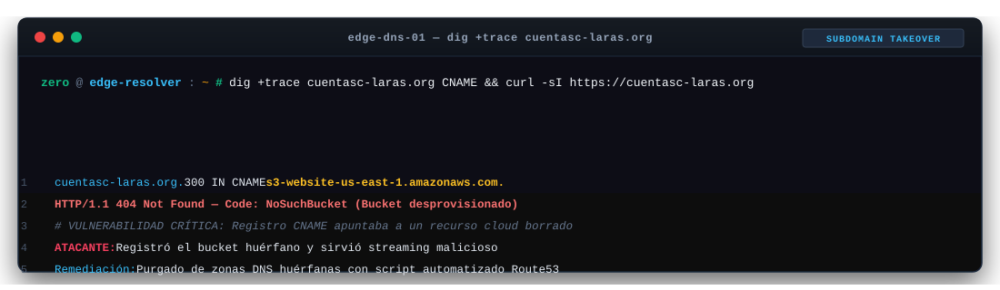

> [!WARNING] **Nota de confidencialidad y contexto:**  
> *Los nombres de organizaciones, proyectos, identificadores de red y credenciales han sido anonimizados por motivos de seguridad y confidencialidad operativa. La arquitectura técnica, la cronología de eventos, los comandos ejecutados, los diagnósticos y las lecciones aprendidas corresponden a un incidente real vivido en producción.*


---

Existe una frase clásica de auditoría que siempre se cumple: **la infraestructura que nadie recuerda es la que más riesgo introduce.**

Durante un inventario consolidado de costos y máquinas virtuales en la nube, nos topamos con un servidor Linode de $5 dólares al mes que figuraba con el nombre `civica-prod-legacy`. Llevaba años facturando silenciosamente.

Al entrar a investigar qué corría en la máquina, descubrimos un escenario digno de un manual de ciberseguridad sobre negligencia en el ciclo de vida de proyectos:
- El servidor corría **Ubuntu 18.04** (sin soporte desde abril de 2023), con servicios de renovación de certificados TLS colapsados.
- Hospedaba una aplicación web de rendición de cuentas políticas construida en 2019 para una organización que llamaremos **Proyecto Cívica**.
- El dominio original (`civica-datos.co`) había expirado meses atrás y fue adquirido por especuladores de dominios: **apuntaba primero a un portal de apuestas y luego redirigía a una radio online.**
- El bucket de AWS S3 que almacenaba las declaraciones de renta y documentos patrimoniales de candidatos ya había sido eliminado.
- Y lo más alarmante: **el servidor seguía conectado por la red privada a la base de datos MySQL de producción de otro cliente totalmente distinto.**

---

## 1. El estado del servidor: un fósil en ejecución





Al conectarnos por SSH encontramos:
- Kernel sin parches desde 2021: `Linux 4.15.0-142-generic`.
- Servicios caídos: `certbot.service` en estado `failed` desde hacía dos años.
- Un proceso `uwsgi` corriendo un proyecto Django de 2019 basado en Python 3.6.

El archivo de configuración de entorno (`.env`) contenía:
- Credenciales de una base de datos PostgreSQL alojada en el servidor de **Proyecto Horizonte** (conexión cruzada entre clientes).
- Claves de acceso de AWS (`AKIA...`) y credenciales de envío masivo de correo de Mailgun.

Al intentar consultar el bucket de almacenamiento configurado:
```bash
$ aws s3 ls s3://civica-documentos-adjuntos/
An error occurred (NoSuchBucket) when calling the ListObjectsV2 operation: The specified bucket does not exist
```

Los adjuntos originales (declaraciones juramentadas, copias de cédulas, certificados de renta) ya se habían perdido o el bucket había sido eliminado en una limpieza anterior en la cuenta de AWS.

---

## 2. La pesadilla del dominio huérfano (*Domain Takeover*)

El síntoma más evidente de abandono fue el dominio web. 

Al consultar el registro DNS:
```bash
$ whois civica-datos.co | grep -E "Creation Date|Registrant"
Creation Date: 2026-09-02T14:18:22Z
Registrant Organization: Domain Privacy Protection Service
```

El dominio institucional había expirado a mediados de 2026. Nadie renovó la suscripción anual. Un bot de subastas de dominios expirados lo compró de inmediato para aprovechar su autoridad histórica de SEO institucional.

Al hacer una petición HTTP al dominio:
- El 20 de octubre: Devolvía contenido de un casino en línea con enlaces a casas de apuestas.
- El 21 de octubre: Devolvía un `HTTP 301 Moved Permanently` hacia una estación de streaming de audio en línea (`black.radio.fm`).

Cualquier ciudadano, periodista o entidad fiscalizadora que buscara los informes de transparencia de candidatos políticos era redirigido a una plataforma de streaming o apuestas comerciales.

---

## 3. La app que ni siquiera podía cargar

Para colmo de males, si intentabas consultar la IP pública del servidor directamente:

```bash
$ curl -I http://198.51.100.99/
# Pasados 39 segundos de silencio...
HTTP/1.1 502 Bad Gateway
```

Al revisar los logs de error de NGINX:
```text
upstream timed out (110: Connection timed out) while connecting to upstream, client: 198.51.100.42, upstream: "uwsgi://127.0.0.1:8000"
```

El servidor web ni siquiera podía arrancar la aplicación. La base de datos PostgreSQL remota a la que intentaba conectarse en el puerto 5432 estaba filtrada por reglas de firewall actualizadas semanas atrás. **El servidor consumía electricidad y generaba costos para arrojar un error 502 en un bucle eterno.**

---

## 4. El protocolo de decomisión segura en orden estricto

Dar de baja un servidor no es solo hacer clic en "Delete Instance". Si eliminas la máquina antes de limpiar sus dependencias, dejas cabos sueltos peligrosos. Seguimos este orden:

```text
1. Copia de Seguridad Forense (Dump Offline)
   └── Respaldar código local y archivos residuales fuera de Git

2. Revocación Inmediata de Credenciales
   └── Desactivar claves IAM de AWS en la consola cloud
   └── Revocar API Keys de Mailgun

3. Aislamiento de Red
   └── Borrar reglas de acceso en el firewall del servidor de base de datos
   └── Bloquear tráfico entrante en ufw

4. Eliminación de la Máquina Virtual
   └── Destruir el nodo en Linode para detener la facturación
```

---

## 5. Lecciones aprendidas

1. **La propiedad del dominio es un activo de seguridad crítico:** Perder el control de un dominio institucional expirado permite a atacantes suplantar la identidad de tu organización (*domain hijacking*), interceptar correos electrónicos dirigidos a cuentas viejas y destruir la reputación de marca.
2. **Monitorea los costos pequeños:** Una instancia de $5 o $10 dólares al mes no llama la atención en la contabilidad, pero suele ser el escondite perfecto de sistemas olvidados y vulnerables. Audita tus facturas mensualmente.
3. **El principio de segregación estricta de clientes:** Dos clientes distintos **nunca** deben compartir la misma instancia de base de datos ni depender de reglas de red cruzadas. Cuando un proyecto muere, debe poder apagarse sin que nadie tenga que preguntarse si otro cliente se verá afectado.
