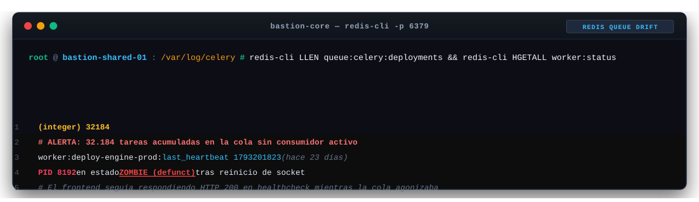

> [!WARNING] **Nota de confidencialidad y contexto:**  
> *Los nombres de organizaciones, proyectos, identificadores de red y credenciales han sido anonimizados por motivos de seguridad y confidencialidad operativa. La arquitectura técnica, la cronología de eventos, los comandos ejecutados, los diagnósticos y las lecciones aprendidas corresponden a un incidente real vivido en producción.*


---

En infraestructuras que crecen a lo largo de varios años es común encontrar aplicaciones legadas que nadie se atreve a tocar: *«No le muevas nada, que por ahí pasan los webhooks de despliegue»*.

Esto fue lo que encontramos con **Sistema Nexus-Deploy** (conocido internamente como `dors`), una aplicación Django que en 2021 recibía webhooks de GitHub, creaba releases automatizados e integraba ramas de código. En el último trimestre de 2026 se acordó finalmente decomisionarla tras migrar la mayoría de los pipelines a GitHub Actions modernos.

Al iniciar el procedimiento de apagado seguro, la realidad nos sorprendió: **la aplicación ya estaba muerta. Llevaba semanas sin ejecutar una sola acción real, acumulaba 32.000 tareas encoladas en memoria y su dominio público compartía la misma dirección IP del bastión de red del cual dependía el acceso a todos los servidores de producción.**

---

## 1. La primera pista falsa: "Esta app corre en Gunicorn"





El primer paso para apagar o migrar un servicio es entender cómo corre. Al inspeccionar el repositorio de código fuente:
- El archivo `Procfile` declaraba: `web: gunicorn nexus.wsgi:application`
- El archivo `supervisord.conf` declaraba: `command=daphne -b 0.0.0.0 -p 8000 nexus.asgi:application`

Sin embargo, al consultar las trazas de errores recientes en Sentry:
```json
{
  "server_name": "deploycloud-node-01",
  "sys.argv": ["uwsgi", "--ini", "/etc/uwsgi/apps-enabled/nexus.ini"],
  "runtime": "Python 3.9.23"
}
```

**La aplicación no corría ni con Gunicorn ni con Daphne.** Corría con un proceso `uwsgi` configurado exclusivamente en el sistema de archivos del servidor, sin versionar en ningún repositorio Git.

> **Regla de oro de operaciones:** Para saber con certeza cómo corre un servicio en producción, inspecciona el servidor en vivo (`ps aux`) o una traza real de Sentry; nunca confíes ciegamente en los archivos de texto del repositorio.

---

## 2. El descubrimiento del zombi: 32.000 tareas en el limbo

Al ingresar al servidor y auditar la instancia local de Redis:

```bash
$ redis-cli -s /var/run/redis/redis.sock info keyspace
# db0:keys=32841,expires=0,avg_ttl=0

$ redis-cli -s /var/run/redis/redis.sock llen queue:default
(integer) 32819
```

Había más de **32.000 mensajes de webhook encolados** en memoria.

Al revisar los procesos del sistema con `systemctl`:
```bash
$ systemctl status nexus-worker.service
● nexus-worker.service - Celery Task Queue Worker
     Loaded: loaded (/etc/systemd/system/nexus-worker.service; enabled)
     Active: failed (Result: exit-code) since Mon 2026-09-14 03:12:18 UTC
   Main PID: 18420 (code=exited, status=1/FAILURE)
```

El worker de Celery había colapsado por una incompatibilidad de librerías hacía casi dos meses y nunca se reinició porque no tenía configurada la directiva `Restart=always`.

### ¿Por qué nadie se quejó?
El servidor web NGINX y el proceso uWSGI seguían arriba y recibían las peticiones HTTP `POST` de los webhooks de GitHub. La vista de Django simplemente ejecutaba `process_webhook.delay(payload)` y devolvía un alegre `HTTP 200 OK` con un cuerpo JSON: `{"status": "queued"}`.

GitHub veía códigos 200 en su historial de entregas. Los desarrolladores ya no usaban la app porque sus flujos habían migrado a GitHub Actions. La app consumía recursos, memoria y CPU recibiendo miles de eventos inútiles que nadie procesaba.

---

## 3. La trampa del dominio y el bastión de red

El plan inicial era simple: apagar la máquina virtual en el proveedor de cloud.

Pero antes de ejecutar `halt`, realizamos una auditoría de DNS y rutas de red:

```bash
$ dig +short app.deploycloud.ejemplo.org
198.51.100.85

$ dig +short bastion.ejemplo.org
198.51.100.85
```

**`app.deploycloud.ejemplo.org` era un registro DNS tipo A que apuntaba directamente a la IP pública del bastión SSH de la organización.** 

Esa misma máquina no era solo el host de la aplicación obsoleta: era el único túnel de entrada para conectarse a los servidores MySQL de producción, a las máquinas de campaña y a los clústeres internos. Si apagábamos el servidor o reasignábamos la IP sin cuidado, dejábamos incomunicado a todo el equipo de infraestructura.

---

## 4. El protocolo de decomisión quirúrgica

Para apagar el servicio sin afectar la red:

1. **Drenaje de tráfico web:** Modificamos la configuración de NGINX en el bastión para responder con `HTTP 410 Gone` a todas las rutas de la app, registrando los User-Agents para confirmar que ningún consumidor crítico siguiera llamándola.
2. **Limpieza de memoria:** Se purgó la base de datos de Redis (`FLUSHDB`) recuperando 450 MB de memoria RAM en el bastión.
3. **Parada y deshabilitación de servicios:**
   ```bash
   sudo systemctl stop uwsgi
   sudo systemctl disable uwsgi
   sudo rm /etc/systemd/system/nexus-worker.service
   sudo systemctl daemon-reload
   ```
4. **Retiro de Webhooks:** Se ejecutó un script en la API de GitHub para eliminar las suscripciones de webhook huérfanas en los 80 repositorios que seguían disparando eventos al servidor.

---

## 5. Lecciones aprendidas

1. **Un HTTP 200 no significa que el sistema esté funcionando:** Si tu endpoint devuelve un acuse de recibo pero delega el trabajo real a una cola asíncrona en segundo plano, tu monitoreo de salud debe verificar el rendimiento de los *workers*, no solo el código de respuesta HTTP.
2. **El principio de servicio único por máquina:** Alojar una aplicación web experimental y un bastión de seguridad crítico en la misma máquina virtual es un antipatrón grave. Cuando llega la hora de decomisionar la app, el riesgo colateral de tumbar la red operativa paraliza la limpieza.
3. **Documenta los decomisos con auditoría previa:** Antes de apagar cualquier servidor, realiza un análisis de DNS cruzado (`dig`), audita las reglas de firewall activas (`ufw status`) y verifica las conexiones abiertas (`ss -tulpn`).
