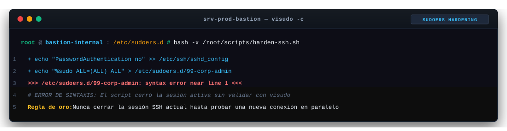

> [!WARNING] **Nota de confidencialidad y contexto:**  
> *Los nombres de organizaciones, proyectos, identificadores de red y credenciales han sido anonimizados por motivos de seguridad y confidencialidad operativa. La arquitectura técnica, la cronología de eventos, los comandos ejecutados, los diagnósticos y las lecciones aprendidas corresponden a un incidente real vivido en producción.*


---

Hay momentos en la vida de un administrador de sistemas donde sientes un frío recorrerte la espalda. Ocurre exactamente en el instante en que presionas Enter en la terminal y ves aparecer:

```text
sudo: effective UID is not 0, is /usr/bin/sudo on a file system with the 'nosuid' option set or an NFS file system without root privileges?
[sudo] password for ubuntu: 
ubuntu is not in the sudoers file. This incident will be reported.
```

Y te das cuenta de que **el script que acabas de ejecutar retiró los permisos de superusuario a tu propia sesión activa antes de configurar la cuenta de reemplazo.**

Este incidente ocurrió durante el piloto de endurecimiento (*hardening*) de accesos SSH en el servidor principal de producción de **Proyecto Horizonte**. La meta era impecable: exigir autenticación en dos factores (2FA/TOTP) a los administradores humanos, crear un usuario de despliegue automatizado con privilegios estrictamente acotados y retirar los permisos de `sudo` total al usuario genérico `ubuntu`.

En el camino descubrimos cuatro trampas operativas que estuvieron a punto de dejarnos sin acceso al servidor en plena hora laboral.

---

## 1. El diseño del acceso: humanos con 2FA, CI con sudo acotado





El plan de seguridad acordado contemplaba tres pilares:

1. **Usuario humano administrador (`core-adm`):** 
   - Autenticación mediante llave SSH Ed25519 obligatoria.
   - Segundo factor TOTP (Google Authenticator) obligatorio al iniciar sesión en SSH (`pam_google_authenticator.so`).
   - Sudo total sin contraseña (`NOPASSWD`), ya que el acceso físico a la consola ya estaba validado con doble factor.
2. **Usuario de despliegue de CI (`app-deployer`):**
   - Sin acceso a 2FA (los pipelines de GitHub Actions no pueden responder desafíos interactivos).
   - Acceso restringido exclusivamente a los 5 comandos necesarios para desplegar versiones bajo `/srv/apps/releases/*` mediante alias específicos en `/etc/sudoers.d/`.
3. **Retiro de privilegios al usuario genérico `ubuntu`:**
   - La cuenta `ubuntu` (creada por defecto por el proveedor de cloud) debía ser despojada de su pertenencia al grupo `sudo`.

---

## 2. El primer tropiezo: dependencias ocultas en el deploy de producción

Antes de tocar una sola línea de configuración, decidimos auditar el script real de despliegue (`atomic-release.sh`) que ejecutaban los pipelines.

La sorpresa fue mayúscula: el pipeline de producción ejecutaba:

```bash
ssh ubuntu@node-prod "sudo mkdir -p /srv/apps/releases/v2026 && sudo chown -R www-data:www-data /srv/apps"
```

El despliegue automático **dependía directamente de que el usuario `ubuntu` tuviera permisos absolutos de superusuario sin restricciones**. Si le quitábamos el sudo a `ubuntu` sin reconfigurar previamente los pipelines, el siguiente despliegue de código caería en error crítico.

Diseñamos entonces una configuración quirúrgica en `/etc/sudoers.d/90-app-deploy`:

```sudoers
# Comandos estrictamente autorizados para el usuario de CI
Cmnd_Alias DEPLOY_CMDS = /bin/mkdir -p /srv/apps/releases/*,                          /bin/chown -R www-data\:www-data /srv/apps/releases/*,                          /usr/bin/rsync --server *,                          /srv/apps/bin/atomic-release.sh

app-deployer ALL=(root) NOPASSWD: DEPLOY_CMDS
```

Probamos la restricción con éxito: `app-deployer` podía ejecutar despliegues, pero si intentaba hacer `sudo whoami` o `sudo cat /etc/shadow`, el sistema rechazaba la orden.

---

## 3. El error de ejecución: el script que se corta la rama donde está sentado

Con el usuario nuevo configurado, procedimos a ejecutar el script final de limpieza. El script se corrió conectado por SSH como el usuario `ubuntu`:

```bash
#!/usr/bin/env bash
# Línea 45: Quitar a ubuntu del grupo sudo
sudo deluser ubuntu sudo

# Línea 50: Configurar permisos del módulo PAM de 2FA
sudo chmod 600 /etc/ssh/totp/core-adm.google_authenticator # <--- ¡FALLÓ AQUÍ!
```

El resultado fue inmediato:
- En la línea 45, `deluser ubuntu sudo` se ejecutó exitosamente con privilegios de root.
- A partir de ese microsegundo, **el usuario `ubuntu` dejó de ser administrador.**
- En la línea 50, cuando el script intentó ejecutar el siguiente `sudo chmod`, el sistema operativo denegó el comando:  
  *`ubuntu is not in the sudoers file. This incident will be reported.`*

El script se interrumpió abruptamente a la mitad. 

El nuevo usuario `core-adm` ya estaba creado, pero **sus permisos de archivo para el token 2FA no se habían fijado**. Si cerrábamos la sesión SSH actual, nos arriesgábamos a quedar bloqueados sin poder entrar por la cuenta vieja ni por la nueva.

---

## 4. El rescate y la regla de las dos terminales

Afortunadamente, el equipo aplicó una regla de oro de supervivencia que nos salvó: **la sesión SSH original nunca se cierra hasta comprobar el acceso en una segunda terminal independiente.**

En la terminal que aún tenía la sesión abierta ejecutamos una comprobación de sockets. Como la sesión de shell ya estaba autenticada, pudimos invocar la consola de rescate del proveedor de cloud (LISH/Consola Serial de Linode) que ingresa directamente como `root` a nivel de hipervisor sin pasar por el demonio SSH.

Desde allí se completó el ajuste:
```bash
# Reparación desde la consola física de rescate:
chmod 600 /etc/ssh/totp/core-adm.google_authenticator
chown core-adm:core-adm /etc/ssh/totp/core-adm.google_authenticator
systemctl restart sshd
```

En la segunda terminal probamos el login con el usuario nuevo:
```bash
ssh core-adm@servidor-prod.ejemplo.org
# Verification code: [Ingresamos el código de 6 dígitos de Google Authenticator]
# Welcome to Ubuntu 22.04 LTS (core-adm@servidor-prod)
$ sudo -n true && echo "Sudo NOPASSWD verificado exitosamente"
Sudo NOPASSWD verificado exitosamente
```

---

## 5. Lecciones aprendidas

1. **Nunca te quites tus propios privilegios en un script:** Si estás ejecutando un script con el usuario `A`, la revocación de permisos a ese usuario debe ser **la última línea del script**, o preferiblemente ejecutarse desde una cuenta independiente o consola de administración.
2. **La regla sagrada de las dos terminales:** Cuando modifiques configuraciones de SSH (`sshd_config`), PAM o `sudoers`, **jamás cierres la sesión en la que estás trabajando**. Abre una segunda ventana de terminal e intenta conectarte desde cero. Si algo falló, la primera sesión te permitirá reparar el daño sin downtime.
3. **Valida la sintaxis con `visudo -c`:** Nunca edites ni muevas archivos a `/etc/sudoers.d/` sin comprobar la integridad sintáctica antes de guardar:
   ```bash
   visudo -c -f /etc/sudoers.d/mi-configuracion
   ```
   Un solo error tipográfico en este directorio puede romper el comando `sudo` para todos los usuarios del sistema operativo.
