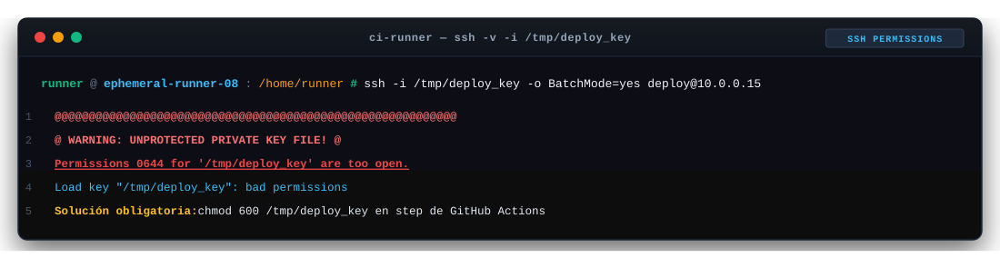

> [!WARNING] **Nota de confidencialidad y contexto:**  
> *Los nombres de organizaciones, proyectos, identificadores de red y credenciales han sido anonimizados por motivos de seguridad y confidencialidad operativa. La arquitectura técnica, la cronología de eventos, los comandos ejecutados, los diagnósticos y las lecciones aprendidas corresponden a un incidente real vivido en producción.*


---

En ingeniería de confiabilidad existe una categoría fascinante de incidentes: **fallos en los que todo el equipo jura que una automatización siempre ha funcionado sola, hasta que una falla revela que jamás estuvo configurada en primer lugar.**

Esto fue lo que descubrimos en el pipeline de despliegue a producción de **Proyecto Horizonte**. Un viernes por la tarde, tras aprobar un hotfix de emergencia en el repositorio principal, el workflow de GitHub Actions falló con un error seco:

```text
Load key "/tmp/deploy_key": invalid format
ubuntu@bastion.ejemplo.org: Permission denied (publickey).
fatal: Could not read from remote repository.
Process completed with exit code 255.
```

El equipo reaccionó con extrañeza: *«¿Alguien cambió las llaves del bastión o expiró la clave de SSH?»*.

La investigación forense del pipeline reveló que el despliegue automático desde GitHub Actions **nunca había funcionado**. Durante casi un año, todos los despliegues exitosos habían sido ejecutados a mano desde la terminal de un ingeniero que tenía su propia llave SSH cargada en memoria.

---

## 1. La arquitectura de acceso: el bastión obligatorio





Para proteger los servidores de producción de Proyecto Horizonte, las máquinas no tienen puertos de administración expuestos a internet. Todo comando de despliegue debe atravesar un **nodo bastión** intermediario:

```text
GitHub Actions Runner ──> [ Bastion Host ] ──> [ Nodo Prod Web ]
                       (SSH Port 2222)      (Red Privada 10.10.x.x)
```

El archivo de workflow `.github/workflows/deploy.yml` contenía los siguientes pasos:

```yaml
- name: Configure SSH Key
  run: |
    mkdir -p ~/.ssh
    echo "${{ secrets.DEPLOY_SSH_KEY }}" > ~/.ssh/id_rsa
    chmod 600 ~/.ssh/id_rsa
    ssh-keyscan -p 2222 bastion.ejemplo.org >> ~/.ssh/known_hosts

- name: Execute Remote Deploy
  run: |
    ssh -p 2222 ubuntu@bastion.ejemplo.org "ssh node-prod 'sudo /srv/apps/deploy.sh'"
```

A simple vista, una configuración impecable.

---

## 2. Tirando del hilo: ¿qué contenía el secreto?

Inspeccionamos los logs del runner en modo de depuración. El error `Load key: invalid format` suele indicar que el contenido inyectado desde el secreto de GitHub no tiene la estructura de una llave PEM u OpenSSH válida.

Utilizando un job de diagnóstico que calculaba el hash SHA256 y la longitud en bytes del secreto sin imprimir su contenido sensible:

```bash
echo -n "$DEPLOY_SSH_KEY" | wc -c
# Resultado: 0 bytes
```

**El secreto `DEPLOY_SSH_KEY` en los Settings del repositorio estaba completamente vacío.**

### ¿Cómo se habían hecho los despliegues anteriores?
Revisamos el historial de despliegues en el servidor de producción. El código se actualizaba periódicamente cada dos o tres semanas. 

Al cruzar los logs de autenticación de SSH en el bastión (`/var/log/auth.log`):
```text
Accepted publickey for ubuntu from 198.51.100.42 port 52310 ssh2: RSA SHA256:d8a9f... [macbook-pro-lead-eng]
```

Todas las ejecuciones provenían de la IP residencial y la llave SSH personal del Líder Técnico. Había creado un script local `deploy-prod.sh` en su máquina que se conectaba al bastión y corría el comando directamente. En el equipo se había asumido que los pushes a `master` desplegaban automáticamente, cuando en realidad dependían de la intervención manual del ingeniero.

---

## 3. Remediación: aprovisionamiento de identidad de máquina

Para independizar el pipeline de credenciales humanas y solucionar el despliegue de raíz:

### Paso 1: Generación de una llave dedicada para CI
Generamos un par de llaves Ed25519 con comentario explícito de auditoría:

```bash
ssh-keygen -t ed25519 -a 100 -C "ci-github-actions-horizonte-prod" -f ./ci_deploy_key
```

### Paso 2: Creación de usuario de servicio acotado en el bastión
En lugar de permitir que GitHub Actions se conectara como el usuario genérico `ubuntu` con privilegios de sudo total, creamos un usuario de servicio exclusivo:

```bash
sudo adduser --system --group --shell /bin/bash ci-deployer
sudo mkdir -p /home/ci-deployer/.ssh
sudo chmod 700 /home/ci-deployer/.ssh
```

En su archivo `authorized_keys` aplicamos restricciones de seguridad de SSH (*forced command scoping*):

```text
# /home/ci-deployer/.ssh/authorized_keys
from="140.82.112.0/20",no-port-forwarding,no-X11-forwarding,no-agent-forwarding ssh-ed25519 AAAAC3NzaC1lZDI1NTE5... ci-github-actions-horizonte-prod
```

### Paso 3: Carga correcta del secreto en GitHub
Cargamos la llave privada limpia en el secreto `DEPLOY_SSH_KEY` de GitHub Actions y verificamos la sintaxis con salto de línea final.

El primer despliegue 100% autónomo se ejecutó a las 18:40 UTC, completando la sincronización en 42 segundos sin depender de ninguna máquina local.

---

## 4. Lecciones aprendidas

1. **La ilusión de la automatización:** Nunca des por sentado que un workflow funciona porque "el código en producción está al día". Revisa el historial de runs en la pestaña Actions de GitHub.
2. **Los secretos vacíos fallan tarde:** Si un script de bash escribe una variable que resulta estar vacía, generará un archivo de cero bytes que fallará tres pasos más adelante. Agrega guardas preventivas en tus workflows:
   ```bash
   if [ -z "$DEPLOY_SSH_KEY" ]; then
     echo "Error crítico: DEPLOY_SSH_KEY no está configurada" >&2
     exit 1
   fi
   ```
3. **Identidades humanas vs Identidades de máquina:** El CI/CD jamás debe compartir llaves SSH con computadores de ingenieros. Si un miembro del equipo se va o pierde su laptop, la rotación de credenciales no debe afectar la entrega continua.
