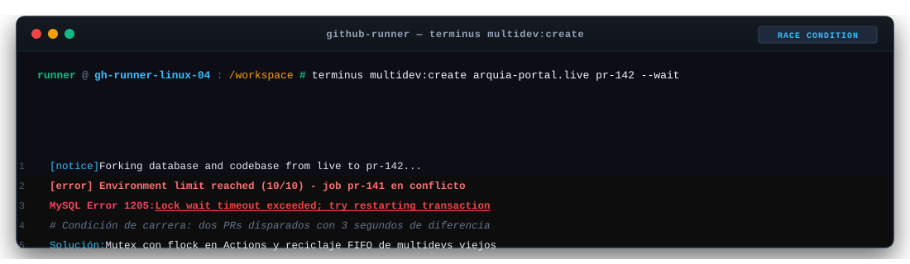

> [!WARNING] **Nota de confidencialidad y contexto:**  
> *Los nombres de organizaciones, proyectos, identificadores de red y credenciales han sido anonimizados por motivos de seguridad y confidencialidad operativa. La arquitectura técnica, la cronología de eventos, los comandos ejecutados, los diagnósticos y las lecciones aprendidas corresponden a un incidente real vivido en producción.*


---

Los entornos efímeros bajo demanda (crear un entorno completo con base de datos y URL propia por cada Pull Request) son el santo grial del desarrollo moderno. Sin embargo, cuando se combinan **APIs asíncronas de infraestructura cloud, timeouts en pipelines de CI y desarrolladores empujando commits con rapidez**, el resultado puede ser desconcertante.

Durante octubre enfrentamos un problema esquivo en varios de nuestros proyectos: de forma aparentemente aleatoria, los entornos de prueba recién creados por GitHub Actions fallaban de formas extrañas:
- En ocasiones, la URL devolvía un frío `404 - Unknown site`.
- Otras veces, la URL cargaba pero redirigía a `/wp-admin/install.php` (WordPress indicando que la base de datos no existía).
- Y en la consola de la plataforma, el entorno figuraba como *Healthy* en la lista de entornos activos.

Tardamos casi un mes y cuatro incidentes en aislar la causa raíz: una sutil **condición de carrera entre dos ejecuciones concurrentes del mismo pipeline**.

---

## 1. La anatomía del workflow de creación





El flujo en GitHub Actions (`setup_environment.yaml`) constaba de tres pasos secuenciales:

```yaml
- name: Create Multidev Environment
  run: terminus multidev:create $SITE.live $BRANCH_NAME

- name: Clone Content from Live
  run: terminus env:clone-content $SITE.live $BRANCH_NAME --files-only=false

- name: Deploy Code Branch
  run: git push pantheon $BRANCH_NAME
```

En condiciones normales de laboratorio, todo funcionaba en unos 4 minutos. Pero en el mundo real, los desarrolladores corrigen un error de linter, hacen un segundo `git commit` y vuelven a hacer `git push` apenas 60 segundos después del primero.

---

## 2. El caso testigo: el timeout engañoso

El 25 de septiembre analizamos el caso del repositorio `portal-dental-forum`:

1. El primer push disparó el workflow Run #412.
2. El comando `terminus multidev:create` envió la petición a la API de la plataforma. La plataforma inició la clonación de contenedores en segundo plano.
3. El comando CLI en el runner de GitHub Actions tiene un timeout de espera de 180 segundos. Como la plataforma estaba bajo alta carga, el CLI arrojó timeout y terminó con código de salida `1`.
4. El pipeline se canceló de inmediato. Los pasos de clonación de base de datos (`clone-content`) nunca se ejecutaron.
5. **Pero en la plataforma cloud, la tarea asíncrona continuó corriendo y completó la creación del contenedor.**

El entorno quedó en un estado "medio nacido":
- Existía el contenedor web.
- Respondía en la lista de `terminus env:list`.
- **Pero no tenía base de datos.** Cualquier visitante que abría la URL caía en la pantalla de instalación limpia de WordPress.

---

## 3. La trampa mortal: el segundo push en paralelo

Para empeorar las cosas, el segundo push del desarrollador (Run #413) se activó mientras el primer entorno incompleto se creaba:

```text
Commit A ───> [multidev:create] ──> (Timeout en CI, pero el cloud sigue creando)
                   │
Commit B ───> Verifica si existe ──> "Ya existe" ──> Hace git push de código
              (Salta creación de BD) ──> Entorno roto permanentemente
```

El Run #413 consultó la API con `terminus multidev:list`. Como la plataforma ya había registrado el nombre del entorno, el script concluyó erróneamente: *«El entorno ya existe, no hace falta crearlo ni clonar base de datos; solo despleguemos el nuevo código»*.

El código se desplegó sobre un contenedor sin base de datos, dejando el PR completamente bloqueado para el equipo de QA.

---

## 4. La solución: Mutex, Concurrency y Verificación de Estado

Para hacer el pipeline 100% resiliente y a prueba de carreras, implementamos tres niveles de protección:

### 1. Cancelación de ejecuciones concurrentes en GitHub Actions
Utilizamos el bloque `concurrency` nativo para garantizar que un nuevo push cancele atómicamente cualquier corrida previa sobre la misma rama:

```yaml
concurrency:
  group: multidev-${{ github.head_ref || github.ref }}
  cancel-in-progress: true
```

### 2. Verificación de salud real (no solo existencia)
Modificamos el script de comprobación para no confiar únicamente en `env:list`. Ahora el script ejecuta una verificación funcional de base de datos antes de decidir si el entorno es viable:

```bash
# Validar si el sitio está realmente instalado
IS_INSTALLED=$(terminus wp $SITE.$BRANCH_NAME -- core is-installed 2>&1 || true)

if [[ "$IS_INSTALLED" != *"The site is installed"* ]]; then
    echo "[!] El entorno existe pero no tiene base de datos sana. Re-clonando contenido..."
    terminus env:clone-content $SITE.live $BRANCH_NAME --yes
fi
```

### 3. Aumento del timeout del cliente CLI
Ajustamos las variables de entorno de Terminus para tolerar picos de congestión en la API del proveedor:

```bash
export TERMINUS_TIMEOUT=600
```

---

## 5. Lecciones aprendidas

1. **Las APIs asíncronas requieren idempotencia:** Si un comando de CLI termina por timeout, nunca asumas que la operación falló en la infraestructura remota. Diseña tus scripts para consultar el estado real del recurso.
2. **Usa `concurrency` en todos tus pipelines de PR:** Permitir que dos workflows compitan por aprovisionar o actualizar el mismo entorno efímero garantiza condiciones de carrera difíciles de diagnosticar.
3. **Existencia no equivale a operatividad:** Que un contenedor o máquina virtual responda en una lista de inventario no significa que sus dependencias (base de datos, almacenamiento de archivos, certificados) estén listas para recibir tráfico.
