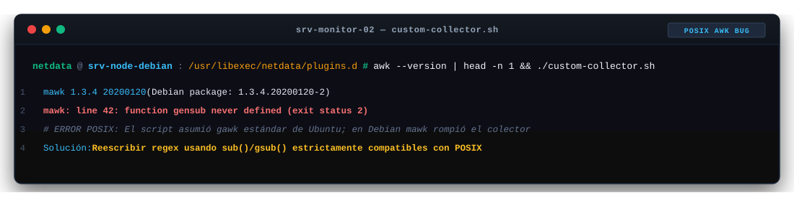

> [!WARNING] **Nota de confidencialidad y contexto:**  
> *Los nombres de organizaciones, proyectos, identificadores de red y credenciales han sido anonimizados por motivos de seguridad y confidencialidad operativa. La arquitectura técnica, la cronología de eventos, los comandos ejecutados, los diagnósticos y las lecciones aprendidas corresponden a un incidente real vivido en producción.*


---

En administración de sistemas heterogéneos hay una lección humillante que se repite generación tras generación: **asumir que comandos universales como `grep`, `sed` o `awk` funcionan igual en todos los servidores Linux es la receta perfecta para corromper archivos de configuración.**

A finales de septiembre ejecutamos una tarea de endurecimiento perimetral en nuestra flota de siete servidores en la nube: asegurar que el servicio de monitoreo en tiempo real **Netdata** escuchara exclusivamente en `127.0.0.1`, eliminando la exposición de su interfaz web en el puerto `19999` hacia internet.

Un asistente de inteligencia artificial generó un script de automatización con `awk` para modificar el archivo `/etc/netdata/netdata.conf`. El script pasó los tests automáticos de QA en un contenedor moderno de Ubuntu 24.04 y fue marcado como *QA PASS*.

Sin embargo, al ejecutar la prueba en seco (*dry-run*) en la flota real, **en dos de los servidores el script duplicó las directivas en lugar de reemplazarlas.**

El motivo era fascinante y desconcertante: esos dos servidores corrían **mawk 1.3.3, un binario compilado en 1996.**

---

## 1. La lógica del script: reemplazar la directiva de bind





El archivo de configuración de Netdata (`netdata.conf`) contiene cientos de líneas comentadas y directivas con sangría variable:

```ini
[web]
    # bind to = *
    bind to = 127.0.0.1
```

Para asegurar que la directiva `bind to` quedara configurada en localhost sin importar cómo estuviera escrita, el script utilizaba una expresión regular en `awk`:

```bash
awk '
BEGIN {{ in_web = 0; replaced = 0 }}
/^\[web\]/ {{ in_web = 1; print; next }}
/^\[/ && !/^\[web\]/ {{ in_web = 0 }}
in_web && /^[[:space:]]*#?[[:space:]]*bind to[[:space:]]*=/ {{
    print "    bind to = 127.0.0.1"
    replaced = 1
    next
}}
{{ print }}
END {{
    if (!replaced) print "\n[web]\n    bind to = 127.0.0.1"
}}
' /etc/netdata/netdata.conf
```

La lógica utilizaba clases de caracteres POSIX estándar (`[[:space:]]`) para coincidir con espacios y tabulaciones, y el ancla `^` para asegurar el inicio de línea.

---

## 2. El fallo en la flota real: ¿por qué se duplicó?

En cinco servidores (Ubuntu 22.04 con GNU awk / `gawk 5.1`), el script reemplazó la directiva limpiamente.

Pero en los dos servidores restantes (`srv-horizonte-db` y `srv-faktur-db`), la salida generada fue:

```ini
[web]
    # bind to = *
    bind to = 127.0.0.1
    bind to = 127.0.0.1
```

¡La directiva no se reemplazaba durante el procesamiento y el bloque `END` agregaba una copia al final!

---

## 3. La arqueología del binario: mawk 1.3.3

Al ingresar a uno de los servidores con fallo y consultar la versión del intérprete:

```bash
$ awk -W version
mawk 1.3.3 Nov 1996, Copyright (C) Michael D. Brennan
compiled for linux-gnu with gcc
```

`mawk` es una implementación ultraligera y rápida de AWK escrita por Mike Brennan a mediados de los 90, que durante muchos años fue el paquete predeterminado `/usr/bin/awk` en instalaciones mínimas de Debian y Ubuntu.

La versión `1.3.3` de 1996 tiene dos limitaciones críticas documentadas en su código fuente en C:
1. **No soporta clases de caracteres POSIX:** Expresiones como `[[:space:]]` no son interpretadas como espacios en blanco; son tratadas literalmente como una clase que busca los caracteres `[`, `:`, `s`, `p`, `a`, `c`, `e`.
2. **Incompatibilidad con el ancla `^` en subexpresiones:** En ciertas combinaciones de expresiones regulares complejas, `mawk 1.3.3` ignora el ancla de inicio de línea dentro de contextos anidados.

Como la expresión `/^[[:space:]]*#?[[:space:]]*bind to/` buscaba la letra `:` en lugar de un espacio, **la condición nunca evaluaba como verdadera.** El script no reemplazaba la línea existente y el bloque `END` añadía una segunda directiva duplicada.

---

## 4. La solución universal y determinista

Para escribir un script que funcione de forma idéntica en GNU awk (`gawk`), `mawk 1.3.3`, `mawk 1.4` y `nawk` (BSD/macOS):

### Reemplazar clases POSIX por conjuntos tradicionales
En lugar de `[[:space:]]`, se utiliza `[ 	]`:

```awk
# Compatible con cualquier awk desde 1988 hasta hoy:
in_web && /^[ \t]*#?[ \t]*bind to[ \t]*=/ {{
    print "    bind to = 127.0.0.1"
    replaced = 1
    next
}}
```

### Manejo seguro de archivos temporales
El script original también cometía otro error común: intentaba crear un archivo temporal en `/etc/netdata/` sin privilegios suficientes:

```bash
# Error en entornos con permisos estrictos:
mktemp "/etc/netdata/netdata.conf.XXXXXX" # Permission denied
```

Se corrigió para utilizar siempre el directorio temporal del sistema con variables de entorno estándar:

```bash
TMP_CONF=$(mktemp "${{TMPDIR:-/tmp}}/netdata.conf.XXXXXX")
awk '...' /etc/netdata/netdata.conf > "$TMP_CONF"
sudo install -m 644 -o root -g root "$TMP_CONF" /etc/netdata/netdata.conf
rm -f "$TMP_CONF"
```

---

## 5. Lecciones aprendidas

1. **Las pruebas en contenedores modernos engañan:** Un test en Ubuntu 24.04 o Debian Bookworm siempre correrá contra versiones modernas de utilidades. Tu infraestructura real suele tener servidores antiguos con paquetes heredados que se comportan de formas inesperadas.
2. **`[ 	]` es más portátil que `[[:space:]]`:** Si estás escribiendo scripts críticos de shell destinados a correr en flotas diversas de servidores Unix/Linux, prefiere los conjuntos de caracteres tradicionales compatibles con estándares de hace 30 años.
3. **El dry-run en producción no es negociable:** Antes de aplicar una mutación en masa con Ansible, scripts o herramientas automáticas, vuelca la salida en un archivo de comparación (`diff -u`) en un servidor real de cada generación de tu parque.
