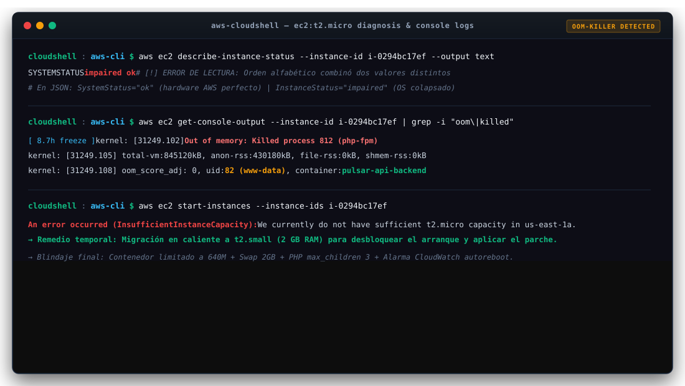

> [!WARNING] **Nota de confidencialidad y contexto:**  
> *Los nombres de organizaciones, proyectos, identificadores de red y credenciales han sido anonimizados por motivos de seguridad y confidencialidad operativa. La arquitectura técnica, la cronología de eventos, los comandos ejecutados, los diagnósticos y las lecciones aprendidas corresponden a un incidente real vivido en producción.*

---

Hay momentos en la vida de un equipo de operaciones donde el contexto te juega una mala pasada. Si una vulnerabilidad crítica con RCE no autenticado estalla en las noticias un lunes, y tu servidor backend colapsa y deja de responder el miércoles, tu cerebro salta inmediatamente a la peor conclusión posible: *«nos hackearon»*.

Esto fue exactamente lo que vivimos con un backend SaaS de analítica que llamaremos **Proyecto Pulsar**. La aplicación corría con Laravel dentro de un contenedor Docker sobre una instancia pequeña de AWS EC2 (`t2.micro` con 1 GB de RAM). 

Apenas dos días después de que se filtrara el aviso oficial de **PHP2Shell** (CVE-2026-109618, CVSS 9.2), el servidor de Pulsar enmudeció por completo. Durante casi nueve horas la máquina no procesó una sola petición y estuvo inaccesible.

Esta es la historia de una investigación bajo máxima presión, de un error de lectura con el CLI de AWS que nos hizo culpar al hardware de la nube, de cómo un kernel Linux sin swap se congela silenciosamente y del diseño de cuatro capas de protección que implementamos para blindar el servicio.

---

## 1. El contexto de paranoia: la semana de PHP2Shell

El 20 de octubre circularon los primeros reportes previos al embargo oficial: **PHP2Shell** permitía ejecución remota de código sin autenticación mediante peticiones HTTP `multipart/form-data` especialmente manipuladas que saturaban y corrompían la gestión de memoria de PHP.

El 21 de octubre PHP publicó los avisos oficiales y las versiones parcheadas (8.2.35, 8.3.36, etc.). Esa misma mañana abrimos un inventario de emergencia de toda la flota de servidores. La aplicación de Pulsar corría **PHP 8.3.30**: estaba dentro del rango vulnerable y marcada con prioridad alta.

Al día siguiente, a las 09:00 COT, la telemetría registró un pico repentino de tráfico de entrada: **10 MB en pocos minutos, casi 100 veces el volumen normal**.
- 09:39–09:48: Tres peticiones `GET` devuelven errores 500 (peticiones directas a la IP sin cabecera de tenant).
- 09:54: El consumo de CPU escala al 100%.
- 09:59:27: Se registra la última línea en el log de Laravel.
- 10:00: **Silencio absoluto.** La instancia deja de recibir tráfico.

El *status check* de la instancia en AWS falló. No había respuesta por HTTP, ni por SSH, ni por ping. La correlación temporal parecía irrefutable: el ataque se había ejecutado y el servidor había caído.

---

## 2. El laberinto del diagnóstico y el tropiezo con AWS CLI

Al día siguiente, tras obtener las credenciales de la cuenta AWS, iniciamos la investigación desde AWS CloudShell. Y aquí cometimos un error de diagnóstico clásico que todo ingeniero debe conocer.

Ejecutamos el comando de inspección de estado de EC2:

```bash
aws ec2 describe-instance-status --instance-id i-0294bc17ef --output text
```

La salida en consola devolvió textualmente:

```text
SYSTEMSTATUS   impaired   ok
```

Al leer de izquierda a derecha en modo texto plano, leímos: *«System Status: Impaired (dañado)»*. Asumimos de inmediato que el hardware físico subyacente de AWS había fallado coincidentemente durante la alerta. Levantamos una ceja, sospechamos del datacenter y estuvimos a punto de abrir un ticket de soporte a Amazon.

Pero algo no encajaba. Decidí repetir el comando forzando la salida en **JSON estructurado**:

```json
{
    "SystemStatus": {
        "Status": "ok"
    },
    "InstanceStatus": {
        "Status": "impaired"
    }
}
```

**El formato de texto plano de AWS CLI ordena los campos alfabéticamente**. `InstanceStatus` y `SystemStatus` se habían colapsado en una sola línea donde `impaired` correspondía al sistema operativo interno y `ok` al hipervisor de AWS. El hardware de AWS estaba perfecto: **el fallo era 100% interno del sistema operativo Linux.**



---

## 3. La autopsia: el OOM-killer que congeló la máquina 9 horas

Al solicitar la captura de consola del sistema (`aws ec2 get-console-output`), la verdad salió a la luz:

```text
[ 8.7h freeze ] kernel: [31249.102] Out of memory: Killed process 812 (php-fpm)
kernel: [31249.105] total-vm:845120kB, anon-rss:430180kB, file-rss:0kB
kernel: [31249.108] oom_score_adj: 0, uid: 82 (www-data)
```

**No hubo intrusión ni malware.** Lo que ocurrió fue un colapso brutal de recursos por diseño:

1. **Configuración de memoria sobredimensionada:** PHP-FPM estaba configurado con `pm.max_children = 5` y un `memory_limit` de `512M`. En una máquina física con solo 1 GB de RAM, permitir que 5 workers puedan solicitar 512 MB cada uno significa que la aplicación puede intentar consumir hasta **2.5 GB de memoria**.
2. **Ausencia total de swap:** La máquina virtual no tenía archivo ni partición de intercambio (*swap*).
3. **El colapso del subsistema de red:** Cuando un worker de PHP intentó procesar una subida pesada y consumió 430 MB, el kernel Linux agotó todas las páginas de memoria física disponibles. El sistema entró en *trashing*, la CPU se fue al 100% intentando liberar memoria y el kernel ni siquiera pudo ejecutar el demonio de recolección de `sysstat` durante 8 horas y 40 minutos.
4. Cuando el kernel finalmente ejecutó el `OOM-killer` y liquidó el proceso de PHP, la pila de red del driver de la interfaz elástica (ENA) quedó en un estado irrecuperable (0 paquetes/s). El servidor parecía encendido, pero era un cadáver viviente en la red.

---

## 4. El obstáculo inesperado: falta de capacidad en la nube

Antes de modificar cualquier cosa en el servidor, aplicamos la regla de oro de SRE: **tomar un snapshot de EBS del disco** (`snap-0b64903b...`) y cerrar temporalmente los puertos 80/443 en el Security Group para trabajar de forma aislada.

Para desbloquear el estado del kernel, detuvimos la instancia con `aws ec2 stop-instances`. Pero al intentar encenderla de nuevo:

```text
An error occurred (InsufficientInstanceCapacity): 
We currently do not have sufficient t2.micro capacity in the Availability Zone us-east-1a.
```

AWS no tenía instancias `t2.micro` disponibles en esa zona en ese instante. Reintentar varias veces no funcionó y el servicio continuaba caído.

**Decisión operativa bajo presión:** Modificamos temporalmente el tipo de instancia a **`t2.small`** (2 GB de RAM). En cuestión de segundos la máquina arrancó, pudimos conectarnos por SSH y empezar a trabajar en la remediación.

---

## 5. El parche y el blindaje en cuatro capas

Al inspeccionar el servidor descubrimos que el código fuente no residía en el host: el despliegue consistía únicamente en un archivo `.env` y un `docker-compose.yml` que apuntaba a una imagen en GitHub Container Registry (`GHCR`) compilada hacía siete meses.

Para parchar PHP2Shell sin romper nada:
1. Reconstruimos localmente la imagen Docker exactamente en el mismo commit de Git (`56d7606`), modificando únicamente la línea base:
   - De: `FROM php:8.3-fpm-alpine`
   - A: `FROM php:8.3.36-fpm-alpine`
2. Verificamos que las firmas MD5 de `composer.lock` e `installed.json` fueran idénticas.
3. Desactivamos el módulo vulnerable de progreso de subidas: `session.upload_progress.enabled=0`.
4. Exportamos la imagen con `docker save | gzip`, la transferimos por SSH y la cargamos en el Docker local.

A las 12:54 COT el servicio estaba de vuelta y completamente parcheado contra PHP2Shell.

### El blindaje en cuatro capas defensivas
Para garantizar que una subida de memoria **nunca más** congele el sistema, diseñamos e implementamos una arquitectura de contención en cuatro niveles:

```defense-layers
blindaje-cuatro-capas
```

Con estas cuatro capas:
- Si un worker se desborda, Docker lo mata de forma aislada sin afectar al resto del sistema operativo.
- Si hay un pico temporal, la swap de 2 GB le da margen de maniobra al kernel.
- Si la tarjeta de red llegara a trabarse por cualquier causa imprevista, CloudWatch reinicia la instancia automáticamente a los 5 minutos sin requerir intervención humana de madrugada.

Una vez verificado que el contenedor en reposo solo consumía ~90 MB de los 640 MB asignados, bajamos la instancia nuevamente al tamaño **`t2.micro`** original para no incrementar la factura de AWS del cliente.

---

## 6. Lecciones para la trinchera técnica

1. **Una máquina sin límites ni swap no se cae: se congela.** Y un servidor congelado es infinitamente peor que un servidor caído: los health checks no siempre lo detectan de inmediato y el OOM-killer puede tardar horas en actuar.
2. **Cuidado con el formato `--output text` en AWS CLI:** El ordenamiento alfabético de campos puede hacerte leer un estado invertido. En incidentes críticos, valida siempre contra JSON.
3. **Snapshot antes de tocar:** En la urgencia de reiniciar, es fácil destruir evidencia o agravar el problema. Tomar una captura de disco toma dos minutos y te da tranquilidad absoluta.
4. **La paranoia del contexto sesga el diagnóstico:** El hecho de que ocurra una caída en la semana de un exploit crítico no significa que la causa sea el exploit. Deja que los logs hablen antes de construir teorías conspirativas.
