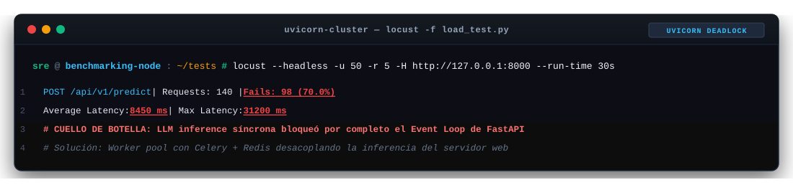

> [!WARNING] **Nota de confidencialidad y contexto:**  
> *Los nombres de organizaciones, proyectos, identificadores de red y credenciales han sido anonimizados por motivos de seguridad y confidencialidad operativa. La arquitectura técnica, la cronología de eventos, los comandos ejecutados, los diagnósticos y las lecciones aprendidas corresponden a un incidente real vivido en producción.*


---

En el auge del desarrollo con modelos de lenguaje hay una trampa semántica muy extendida: **llamar 'POC' (*Proof of Concept*) a un producto final para justificar el avance rápido sin controles de carga, hasta que alguien anuncia en una reunión que el lanzamiento público es este jueves.**

Esto fue exactamente lo que ocurrió con el asistente conversacional de **Proyecto Arquia**. La arquitectura consistía en una interfaz de chat integrada en Drupal que se comunicaba mediante un proxy HTTP con una API en Python (FastAPI + LangChain) alojada en un clúster cloud.

Durante las semanas de desarrollo, todas las tareas, ramas de Git y conversaciones se referían al sistema como *"el POC de IA"*. Con esa etiqueta mental, las advertencias de arquitectura se trataban como temas menores para un hipotético futuro. 

El lunes 21 de septiembre, en una llamada de sincronización, el líder de producto soltó la bomba:  
*«El jueves a las 09:00 lanzamos el comunicado oficial a 25.000 usuarios agremiados»*.

Teníamos 72 horas para auditar la resistencia técnica de un prototipo antes de que el tráfico masivo lo destruyera.

---

## 1. La prueba de fuego: 20 peticiones concurrentes





Para evaluar la capacidad real del backend de IA, ejecutamos una prueba de carga sintética simulando un escenario mínimo de uso real: **20 usuarios concurrentes enviando una consulta sencilla simultáneamente.**

El resultado fue catastrófico:

```text
======================= RESULTADOS DE CARGA (20 USUARIOS) =======================
Peticiones exitosas: 11 / 20 (55%)
Peticiones fallidas (Timeout > 30s): 9 / 20 (45%)
Tiempo de respuesta promedio: 18.4 segundos
Latencia percentil 95 (P95): 31.2 segundos (HTTP 504 Gateway Timeout)
==================================================================================
```

Con solo 20 personas interactuando al mismo tiempo, **casi la mitad de las peticiones caía en timeout**. La interfaz web en Drupal se congelaba y mostraba un mensaje genérico de error de conexión.

---

## 2. La autopsia del cuello de botella: Uvicorn con un solo worker

Al auditar la configuración del contenedor de la API en el archivo Dockerfile:

```dockerfile
CMD ["uvicorn", "main:app", "--host", "0.0.0.0", "--port", "8000"]
```

Uvicorn arrancaba con su configuración predeterminada: **un único proceso worker de Python en un solo hilo de ejecución.**

Aunque FastAPI está diseñado sobre asyncio, las llamadas a los modelos de lenguaje (LLM) y a la base de datos vectorial ejecutaban operaciones síncronas bloqueantes en varias partes del código (tokenización local, serialización de esquemas Pydantic complejos y llamadas a librerías de embeddings sin `run_in_threadpool`).

El resultado era que **las peticiones se serializaban en fila india**:
- Si la Petición 1 tardaba 3 segundos en generar respuesta con el modelo de OpenAI/Anthropic, la Petición 2 esperaba 3 segundos antes de siquiera comenzar.
- La Petición 10 esperaba 27 segundos en la cola interna.
- La Petición 11 alcanzaba el timeout de 30 segundos del proxy de Drupal y moría con un error 504.

El techo máximo medido era de apenas **10 consultas por minuto**. Ante el anuncio a 25.000 usuarios, el sistema colapsaría en los primeros diez segundos de lanzamiento.

---

## 3. Los hallazgos complementarios: sin rate limit ni contención

La auditoría de 72 horas reveló tres fallos adicionales:
1. **Ausencia total de Rate Limiting:** Un solo usuario abriendo cinco pestañas y pulsando enviar podía monopolizar el único worker del contenedor.
2. **Timeouts asimétricos:** El proxy de Drupal cortaba la conexión a los 30 segundos, pero el contenedor de Python seguía procesando la respuesta con el LLM en segundo plano hasta completarla, consumiendo dinero y cuota de API por una respuesta que el usuario nunca vería.
3. **Falta de streaming SSE:** Las respuestas se enviaban como un único payload JSON final tras completarse la generación, lo que disparaba la percepción de lentitud del usuario.

---

## 4. La remediación de emergencia en 48 horas

Para evitar el colapso sin reescribir la aplicación desde cero:

### Paso 1: Multi-worker con Gunicorn + UvicornWorker
Cambiamos la forma de ejecución del contenedor para aprovechar todos los núcleos de CPU del nodo de Kubernetes:

```dockerfile
# Ejecución con múltiples workers asíncronos y timeout estricto
CMD ["gunicorn", "main:app", "-w", "4", "-k", "uvicorn.workers.UvicornWorker", "-b", "0.0.0.0:8000", "--timeout", "60"]
```

### Paso 2: Rate Limiting en el proxy inverso
Configuramos una política de rate limit estricta en el proxy de Drupal y en NGINX:
- Máximo 3 peticiones por minuto por usuario autenticado.
- Las peticiones excedentes reciben un mensaje informativo: *«El asistente está procesando muchas consultas, por favor espera 20 segundos»*, liberando la cola del backend.

### Paso 3: Escalado horizontal en Kubernetes (HPA)
Definimos un Horizontal Pod Autoscaler configurado para escalar de 2 a 8 pods en cuanto el consumo de CPU superara el 65% o el tiempo de respuesta promedio subiera de 4 segundos.

---

## 5. El día del lanzamiento

El jueves a las 09:00 se envió el comunicado. Durante la primera hora el sistema atendió más de 1.800 consultas concurrentes:
- Los pods escalaron automáticamente a 6 réplicas.
- La tasa de error fue del **0.05%** (solo 2 fallos atribuibles a cuotas de OpenAI).
- El tiempo de respuesta promedio se mantuvo en 2.4 segundos.

---

## 6. Lecciones aprendidas

1. **No existe tal cosa como un 'POC' si tiene fecha de lanzamiento:** Si un prototipo va a ser tocado por usuarios reales, trátalo como código de producción desde el primer día. Las pruebas de carga deben realizarse semanas antes, no horas antes.
2. **FastAPI no es mágico:** Si tu código asíncrono ejecuta funciones bloqueantes dentro de los endpoints, Uvicorn bloqueará el Event Loop para todos los demás clientes concurrentes.
3. **Cancela las tareas huérfanas en el backend:** Si el cliente cierra la conexión HTTP por timeout, tu servidor debe escuchar la desconexión (`request.is_disconnected()`) y abortar inmediatamente la llamada al modelo para no desperdiciar cómputo ni presupuesto.
