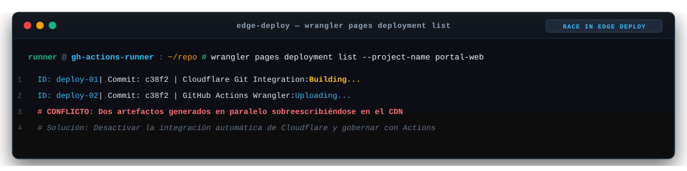

> [!WARNING] **Nota de confidencialidad y contexto:**  
> *Los nombres de organizaciones, proyectos, identificadores de red y credenciales han sido anonimizados por motivos de seguridad y confidencialidad operativa. La arquitectura técnica, la cronología de eventos, los comandos ejecutados, los diagnósticos y las lecciones aprendidas corresponden a un incidente real vivido en producción.*


---


En organizaciones medianas que manejan decenas de microservicios y funciones serverless, hay un riesgo silencioso que no aparece en los escáneres de vulnerabilidades: **la contradicción de políticas operativas aprobadas por diferentes líderes técnicos en el mismo sprint.**

A finales de septiembre recibimos una tarea urgente de gobernanza de despliegues:  
*«Garantizar que ningún repositorio publique código automáticamente a producción con solo hacer merge a la rama master; todo despliegue a producción debe requerir un tag o un evento manual explícito»*.

El objetivo era proteger 24 repositorios que gestionaban funciones serverless en **Cloudflare Workers** y aplicaciones estáticas en **Cloudflare Pages**.

Al iniciar el inventario de los pipelines nos encontramos con una paradoja fascinante: apenas dos semanas antes, otra directriz de optimización de entrega continua había sido aprobada e implementada en la mitad de esos mismos repositorios con la orden opuesta:  
*«Eliminar fricción: todo merge a master debe desplegar inmediatamente a producción o fallar de forma estruendosa»*.

Dos políticas diametralmente opuestas estaban activas al mismo tiempo sobre la misma flota de repositorios.

---

## 1. La radiografía del inventario: 24 repositorios y tres realidades





Para tomar decisiones basadas en datos y no en suposiciones, auditamos los 24 repositorios clasificándolos según su mecanismo real de entrega:

```text
[UNIVERSO DE 24 REPOSITORIOS CLOUD SERVERLESS]
├── 1 Repositorio con política madura (Proyecto Horizonte)
│   └── Deploy exclusivo por dispatch manual con verificación de ancestros Git.
├── 7 Repositorios con auto-despliegue en push a master
│   └── GitHub Actions ejecutando wrangler-action directamente en cada merge.
└── 16 Repositorios delegados a Cloudflare Pages
    └── El propio panel web de Cloudflare escuchaba webhooks de GitHub.
```

### El hallazgo crítico en los 7 repositorios de Actions
En proyectos como `microservicio-ventas` y `portal-pagos`, el archivo `.github/workflows/deploy.yml` tenía:

```yaml
on:
  push:
    branches: [master] # <--- ¡Cualquier merge publicaba en vivo!

jobs:
  deploy:
    runs-on: ubuntu-latest
    steps:
      - uses: actions/checkout@v4
      - name: Deploy to Cloudflare Workers
        uses: cloudflare/wrangler-action@v3
        with:
          apiToken: ${{{{ secrets.CLOUDFLARE_API_TOKEN }}}}
          environment: production
```

Para empeorar la situación: dos de esos repositorios tenían activada la función de **auto-merge de Dependabot**. Si Dependabot abría un PR actualizando una librería menor y los tests pasaban, GitHub hacía merge automático y el cambio se iba directo a los servidores de producción de madrugada sin supervisión humana.

---

## 2. El obstáculo del token inválido en la auditoría

Para auditar los 16 proyectos restantes configurados en Cloudflare Pages, necesitábamos consultar la API de Cloudflare con el CLI oficial `wrangler` para revisar si la rama de producción configurada en el panel era `master` o `production`:

```bash
$ npx wrangler pages project list
ERROR: Authentication error: Invalid API Token (Code 10000)
```

El token `CLOUDFLARE_API_TOKEN` almacenado en el entorno de desarrollo central había sido revocado días atrás. Sin acceso a la API del proveedor de cloud, la mitad de los repositorios era una caja negra.

En lugar de detener la auditoría:
1. Inspeccionamos la configuración estática de los repositorios (`wrangler.toml`).
2. Solicitamos un token temporal de solo lectura con alcance acotado (`Pages:Read`, `Workers:Read`) para completar la auditoría sin privilegios destructivos.

---

## 3. El debate técnico: ¿Entrega Continua Total o Control de Cambios?

Nos sentamos con ambos líderes técnicos a resolver el conflicto de fondo:

- **Postura A (Velocidad):** Para microservicios internos desacoplados, exigir un tag manual por cada commit ralentiza el desarrollo y desalienta los despliegues pequeños y frecuentes.
- **Postura B (Control de Riesgo):** Para servicios que tocan pagos o bases de datos de producción, un merge involuntario o un auto-merge de un bot no supervisado puede causar una catástrofe financiera.

### El consenso: La política de dos niveles
Establecimos una matriz clara de gobernanza:

1. **Servicios de Nivel 1 (Críticos / Pagos / Datos):**
   - El push a `master` despliega exclusivamente al entorno de **Staging**.
   - El despliegue a **Producción** exige la creación de un tag semántico (`v*.*.*`) o un disparo manual explícito (`workflow_dispatch`) con aprobación de dos ingenieros en GitHub Environments.
   - Prohibido el auto-merge de Dependabot en la rama principal.

2. **Servicios de Nivel 2 (Documentación / Sitios Estáticos / Micro-APIs de lectura):**
   - Permitido el despliegue automático en merge a `master`, pero con una ventana de retención (*canary deploy*) del 10% del tráfico durante 15 minutos en Cloudflare.

---

## 4. La implementación técnica: GitHub Environments

Para los servicios de Nivel 1, refactorizamos el workflow utilizando las protecciones nativas de GitHub Environments:

```yaml
name: Deploy Production Worker

on:
  release:
    types: [published]
  workflow_dispatch:

jobs:
  deploy:
    runs-on: ubuntu-latest
    environment: production # Exige aprobación manual en la interfaz de GitHub
    steps:
      - uses: actions/checkout@v4
      - name: Deploy Worker
        run: npx wrangler deploy --env production
```

Con este ajuste:
- Los desarrolladores pueden mergear PRs a `master` continuamente sin miedo a romper producción.
- El despliegue real requiere una acción consciente y documentada en la pestaña Releases.

---

## 5. Lecciones aprendidas

1. **Alinea las políticas de ingeniería antes de escribir código:** Cuando dos iniciativas con objetivos válidos (velocidad vs control) no se coordinan a nivel de liderazgo, los equipos terminan implementando soluciones contradictorias que generan caos.
2. **Cuidado con el auto-merge de bots en ramas de producción:** Permitir que bots como Dependabot hagan merge automático sobre ramas que disparan despliegues directos a producción es abdicar del control operativo. Los bots deben mergear hacia ramas de integración o staging.
3. **Usa GitHub Environments para aprobaciones formales:** En lugar de inventar scripts complejos de validación en bash, utiliza la funcionalidad nativa de entornos protegidos de GitHub: te otorga registros de auditoría, aprobadores obligatorios y protección de secretos por nivel.
