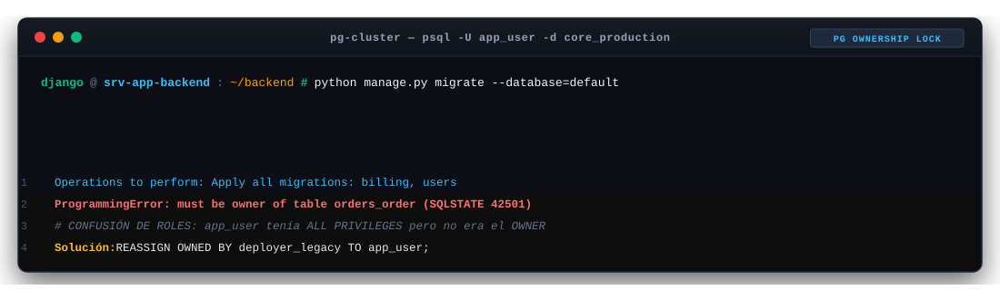

> [!WARNING] **Nota de confidencialidad y contexto:**  
> *Los nombres de organizaciones, proyectos, identificadores de red y credenciales han sido anonimizados por motivos de seguridad y confidencialidad operativa. La arquitectura técnica, la cronología de eventos, los comandos ejecutados, los diagnósticos y las lecciones aprendidas corresponden a un incidente real vivido en producción.*


---

En PostgreSQL existe una distinción fundamental que a menudo toma por sorpresa a desarrolladores experimentados: **tener `GRANT ALL PRIVILEGES` sobre una base de datos no te convierte en el dueño (*owner*) de sus tablas.**

Vivimos este problema en el backend financiero de **Proyecto AgroFin**, una plataforma desarrollada en Django que procesa transacciones agrícolas y contratos de crédito. Durante una actualización de esquema en el entorno de staging que debía preparar el despliegue a producción, el comando `python manage.py migrate` se estrelló con un error fatal:

```text
django.db.utils.ProgrammingError: must be owner of table facturacion_facturaelectronica
```

La aplicación llevaba meses funcionando normalmente: insertaba, consultaba, actualizaba y eliminaba registros sin ningún inconveniente. Sin embargo, en el instante en que Django intentó ejecutar un `ALTER TABLE` para agregar una columna indexada, el motor de base de datos le cerró la puerta.

---

## 1. El síntoma y la trampa del `GRANT`





La primera reacción del equipo fue conectarse a la consola de PostgreSQL con el usuario administrador y otorgar todos los permisos posibles al usuario de la aplicación:

```sql
GRANT ALL PRIVILEGES ON DATABASE agrofin_db TO user_agrofin_app;
GRANT ALL ON SCHEMA facturacion TO user_agrofin_app;
GRANT ALL ON ALL TABLES IN SCHEMA facturacion TO user_agrofin_app;
```

Se reintentó la migración:
```bash
$ python manage.py migrate
django.db.utils.ProgrammingError: must be owner of table facturacion_facturaelectronica
```

El error persistía exactamente igual.

### ¿Por qué falla?
En el modelo de seguridad de PostgreSQL:
- `GRANT ALL` sobre una tabla otorga privilegios DML (`SELECT`, `INSERT`, `UPDATE`, `DELETE`, `TRUNCATE`, `REFERENCES`).
- **Solo el propietario (*owner*) del objeto o un superusuario** tiene autorización para ejecutar operaciones DDL (`ALTER TABLE`, `DROP TABLE`, `CREATE INDEX`, cambios de tipo de datos).

Al inspeccionar los metadatos de las tablas:
```sql
SELECT tablename, tableowner FROM pg_tables WHERE schemaname = 'facturacion';
```
```text
          tablename           |  tableowner  
------------------------------+--------------
 facturacion_facturaelectronica| admin_db
 facturacion_detallefactura   | admin_db
 crm_cliente                  | admin_db
```

Las tablas habían sido creadas originalmente durante una restauración manual de backup ejecutada por un administrador de sistemas conectado como `admin_db`. Como resultado, la aplicación (`user_agrofin_app`) tenía permisos de uso, pero no era la dueña.

---

## 2. La trampa no obvia: secuencias `SERIAL` e `IDENTITY`

Reasignar la propiedad de las tablas parecía tan simple como ejecutar un bucle de `ALTER TABLE ... OWNER TO user_agrofin_app`.

Pero al llegar a las columnas de clave primaria autonuméricas (`SERIAL`), apareció un segundo tropiezo:

```sql
ALTER SEQUENCE facturacion_facturaelectronica_id_seq OWNER TO user_agrofin_app;
-- ERROR: sequence must belong to owner of table "facturacion_facturaelectronica"
```

En PostgreSQL, si intentas reasignar la secuencia antes de cambiar la tabla (o viceversa de forma aislada), el catálogo rechaza la orden. La secuencia está ligada como dependencia estricta (`pg_depend`) a la columna de la tabla.

---

## 3. La remediación determinista: bloque PL/pgSQL

Para corregir la propiedad de cientos de tablas distribuidas en múltiples esquemas (`facturacion`, `crm`, `interfaces`, `sarlaft`) sin cometer errores manuales, diseñamos un bloque procedural en PL/pgSQL que recorre el catálogo dinámicamente:

```sql
DO $$
DECLARE
    r RECORD;
    target_user TEXT := 'user_agrofin_app';
    target_schemas TEXT[] := ARRAY['facturacion', 'crm', 'interfaces', 'sarlaft', 'public'];
    sch TEXT;
BEGIN
    FOREACH sch IN ARRAY target_schemas
    LOOP
        -- 1. Cambiar propietario del esquema
        EXECUTE format('ALTER SCHEMA %I OWNER TO %I', sch, target_user);

        -- 2. Cambiar propietario de todas las tablas (arrastra secuencias dependientes)
        FOR r IN (SELECT tablename FROM pg_tables WHERE schemaname = sch)
        LOOP
            EXECUTE format('ALTER TABLE %I.%I OWNER TO %I', sch, r.tablename, target_user);
        END LOOP;

        -- 3. Cambiar propietario de secuencias huérfanas
        FOR r IN (SELECT sequencename FROM pg_sequences WHERE schemaname = sch)
        LOOP
            EXECUTE format('ALTER SEQUENCE %I.%I OWNER TO %I', sch, r.sequencename, target_user);
        END LOOP;

        -- 4. Cambiar propietario de vistas
        FOR r IN (SELECT table_name FROM information_schema.views WHERE table_schema = sch)
        LOOP
            EXECUTE format('ALTER VIEW %I.%I OWNER TO %I', sch, r.table_name, target_user);
        END LOOP;
    END LOOP;
END $$;
```

---

## 4. Garantizar el futuro: `ALTER DEFAULT PRIVILEGES`

Cambiar el estado actual no evita que un futuro backup o script manual ejecutado como superusuario vuelva a romper los permisos. Para resolverlo de forma permanente, configuramos privilegios por defecto:

```sql
ALTER DEFAULT PRIVILEGES FOR ROLE admin_db IN SCHEMA facturacion 
    GRANT ALL ON TABLES TO user_agrofin_app;

ALTER DEFAULT PRIVILEGES FOR ROLE admin_db IN SCHEMA facturacion 
    GRANT ALL ON SEQUENCES TO user_agrofin_app;
```

Tras ejecutar la solución, el comando de migraciones de Django corrió en menos de tres segundos:

```bash
$ python manage.py migrate
Operations to perform:
  Apply all migrations: facturacion, crm
Running migrations:
  Applying facturacion.0014_add_electronic_invoice_hash... OK
  Applying crm.0009_update_tax_identifiers... OK
```

---

## 5. Lecciones aprendidas

1. **Nunca restaures backups con el superusuario sin fijar el rol:** Al usar `pg_restore`, utiliza siempre el parámetro `--no-owner --role=usuario_app` para garantizar que los objetos nazcan con el dueño correcto.
2. **Diferencia entre permisos de datos y permisos de catálogo:** Si tu aplicación corre migraciones automáticas (`ALTER TABLE`, `CREATE INDEX`), no le basta con permisos DML: debe ser la dueña legítima del esquema y de sus objetos.
3. **Las secuencias son esclavas de sus tablas:** No intentes forzar cambios en secuencias autonuméricas de manera independiente; transfiere la propiedad de la tabla contenedora y PostgreSQL alineará las dependencias.
