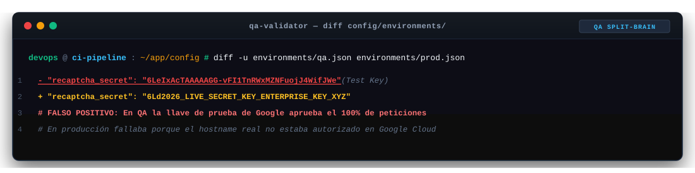

> [!WARNING] **Nota de confidencialidad y contexto:**  
> *Los nombres de organizaciones, proyectos, identificadores de red y credenciales han sido anonimizados por motivos de seguridad y confidencialidad operativa. La arquitectura técnica, la cronología de eventos, los comandos ejecutados, los diagnósticos y las lecciones aprendidas corresponden a un incidente real vivido en producción.*


---

En desarrollo web hay una frase clásica de cierre de sprint que infunde falso alivio:  
*«Ya pasó QA en staging, podemos pasar a producción»*.

Este incidente ocurrido en el portal institucional de **Proyecto Arquia** (un sitio Drupal en arquitectura PaaS) nos enseñó por qué esa frase puede ser un espejismo cuando intervienen tres factores concurrentes: **módulos de división de configuración (*config split*), scripts de tema con validaciones agresivas y capas de caché agresivas que enmascaran el estado real del código.**

Lo que empezó como una tarea preventiva de cinco minutos para no utilizar la clave de API real de Google reCAPTCHA en los entornos de desarrollo terminó convirtiéndose en un laberinto de un mes.

---

## 1. El objetivo inicial: aislar las llaves de producción





En Drupal, es una mala práctica que los entornos de `dev` y `test` envíen eventos a la cuenta de reCAPTCHA de producción. La tarea solicitaba:
1. Usar las credenciales reales de reCAPTCHA únicamente en el entorno `live`.
2. En entornos fuera de producción, recurrir a un captcha matemático nativo o dejar el formulario libre para pruebas automatizadas.

El desarrollador asignado implementó el cambio en `settings.php` mediante el Pull Request `#2782`:

```php
// settings.php
if (defined('PANTHEON_ENVIRONMENT') && PANTHEON_ENVIRONMENT === 'live') {
    $config['recaptcha.settings']['secret_key'] = $secrets['recaptcha_secret_key'];
} else {
    // Fuera de live no se define la llave secreta
    $config['recaptcha.settings']['secret_key'] = '';
}
```

En la máquina local del desarrollador funcionó. Se desplegó a `test` y el equipo de QA reportó: *«Verificado, el formulario funciona»*.

---

## 2. El primer tropiezo: el iframe roto y la clave pública

Días después, un usuario de pruebas reportó un error visual estridente en el entorno de staging:

```text
ERROR for site owner: Invalid domain for site key
```

El iframe de Google reCAPTCHA se renderizaba en rojo en medio del formulario.

### La causa
El PR anterior solo había vaciado `secret_key` (la clave privada en el servidor), pero **había dejado intacta `site_key` (la clave pública que se envía al navegador)** en la base de datos de configuración sincronizada (`config/sync/recaptcha.settings.yml`).

Como Google reCAPTCHA v3 valida el dominio del cliente contra la lista autorizada en la consola de Google, al ejecutarse desde un dominio `test-arquia.ejemplo.org` no registrado, el widget de Google arrojaba un error perimetral que bloqueaba la interfaz.

---

## 3. La segunda sorpresa: el split que no era un split

Para solucionar el problema, el equipo intentó utilizar la herramienta nativa de Drupal para separar configuraciones por entorno: **Config Split** (`config_split.live_split`). La idea era que `site_key` solo se importara en producción.

Al revisar la configuración descubrimos una sorpresa:

```php
// settings.php línea 64
if (defined('PANTHEON_ENVIRONMENT')) {
    $config['config_split.config_split.live_split']['status'] = TRUE;
}
```

El condicional evaluaba si existía la constante `PANTHEON_ENVIRONMENT`, ¡la cual existe en **todos** los entornos (`dev`, `test`, `live` y multidevs)! 

Por lo tanto, **el supuesto 'split exclusivo de live' se estaba aplicando a toda la flota.** Si vaciábamos `site_key` en esa configuración, rompíamos el formulario en producción real.

---

## 4. El bloqueo en JavaScript del tema

Tras corregir la lógica del split para aislar de verdad a `live`, surgió un síntoma aún más desconcertante: en el entorno `test`, al hacer clic en *Enviar*, el formulario simplemente no hacía nada.

Al abrir la consola de desarrollo del navegador:

```javascript
// webform-recaptcha-consent.js (línea 42)
if (!grecaptcha.getResponse()) {
    alert("Por favor complete la verificación de seguridad antes de continuar.");
    event.preventDefault();
    return false;
}
```

El tema institucional contenía un script propio de JavaScript que interceptaba el evento `submit` y cancelaba la petición si el objeto `grecaptcha` no devolvía un token válido. Como habíamos retirado el widget en `test`, el script de frontend entraba en un bucle ciego y hacía imposible enviar el formulario.

---

## 5. El falso positivo del reporte de QA: la trampa del caché

¿Cómo fue posible que el reporte inicial dijera que todo funcionaba?

Hicimos una inspección de los encabezados HTTP que devolvía la plataforma durante la prueba de QA:

```http
HTTP/2 200 OK
X-Cache: HIT
X-Cache-Hits: 14
Age: 86420
```

El entorno `test` tenía una capa de caché de Varnish con TTL de varios días. Cuando el revisor de QA abrió la página para probar, **estaba interactuando con una versión estática compilada 24 horas antes del despliegue del PR**. El formulario que probó era el formulario antiguo. Dio el visto bueno sobre un fantasma en memoria.

---

## 6. Remediación integral

Para resolver los cuatro problemas de forma armónica:

1. **Frontend:** Se modificó `webform-recaptcha-consent.js` para realizar una salida temprana limpia:
   ```javascript
   if (typeof grecaptcha === 'undefined' || !drupalSettings.recaptcha) {
       // Si el entorno no tiene reCAPTCHA activo, permitir el envío normal
       return true;
   }
   ```
2. **Backend:** Se condicionó estrictamente la carga de llaves y del split:
   ```php
   $is_production = (defined('PANTHEON_ENVIRONMENT') && PANTHEON_ENVIRONMENT === 'live');
   $config['config_split.config_split.live_split']['status'] = $is_production;
   ```
3. **Pipeline de despliegue:** Se agregó una directiva de purga atómica de caché (`terminus env:clear-cache`) en cada paso de CI/CD para que ningún revisor vuelva a evaluar páginas zombis.

---

## 7. Lecciones aprendidas

1. **Desconfía de las pruebas en páginas con caché:** Antes de iniciar cualquier sesión de QA o validación post-despliegue, verifica en los headers HTTP que `Age: 0` o haz un bypass forzado con parámetros de consulta (`?nocache=1`).
2. **Las llaves públicas también tienen lógica:** Proteger un secreto no es solo esconder la `secret_key`. Si la `site_key` pública depende de una validación de dominio de terceros, también debe aislarse por entorno.
3. **El frontend debe tolerar la ausencia de servicios auxiliares:** Si un servicio de analítica o captcha no carga o está deshabilitado, tus formularios nunca deben colapsar por una excepción no controlada en JavaScript.
