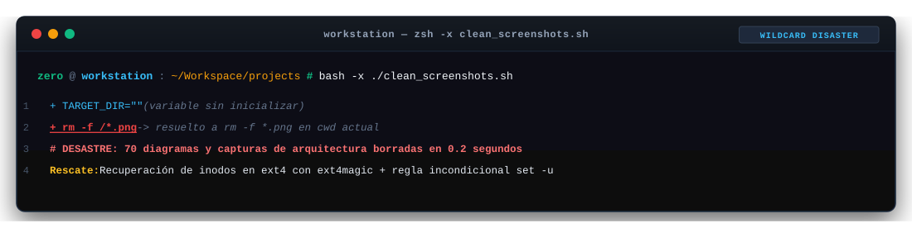

> [!WARNING] **Nota de confidencialidad y contexto:**  
> *Los nombres de organizaciones, proyectos, identificadores de red y credenciales han sido anonimizados por motivos de seguridad y confidencialidad operativa. La arquitectura técnica, la cronología de eventos, los comandos ejecutados, los diagnósticos y las lecciones aprendidas corresponden a un incidente real vivido en producción.*


---

Hay dos tipos de ingenieros en operaciones: **los que han ejecutado un comando destructivo irreversible por comodidad en la terminal, y los que están a punto de hacerlo.**

Este artículo no trata sobre una vulnerabilidad zero-day ni sobre un ataque sofisticado. Trata sobre un error humano propio, directo y evitable: cómo un comando `rm -f *.png` ejecutado a la ligera en un directorio compartido eliminó de un plumazo 70 capturas de pantalla de auditorías visuales y evidencias forenses acumuladas durante meses.

En la cultura blameless post-mortem, admitir los errores propios con precisión clínica es la única forma de construir sistemas y hábitos que impidan que vuelvan a repetirse.

---

## 1. El contexto de la tarea





Estábamos trabajando en el rediseño y aseguramiento de un componente de interfaz con navegación tipo *glassmorphism* para un panel interno (`dashboard-tareas`). Para verificar la fidelidad visual entre diferentes resoluciones, ejecutamos un script con **Playwright** que realizaba capturas de pantalla automatizadas del navegador.

Durante la sesión se fueron generando capturas como:
- `viewport-1920-dark.png`
- `viewport-mobile-ios.png`
- `nav-glass-blur.png`

Al principio, cada vez que terminaba una tanda de validación, el procedimiento de limpieza era cuidadoso y explícito:

```bash
rm -f ./reports/viewport-1920-dark.png ./reports/nav-glass-blur.png
```

Se borraba únicamente lo que se acababa de crear, con rutas relativas específicas.

---

## 2. La relajación de disciplina: el comodín de la discordia

Hacia el final de una larga sesión de depuración, tras iterar una docena de veces con ajustes de CSS, la carpeta raíz del espacio de trabajo temporal (`~/Swapps/`) tenía varias capturas de prueba dispersas.

En lugar de listar los archivos generados o borrarlos por prefijo exacto, entró en juego el atajo de la pereza mental:

```bash
# El comando destructivo
$ rm -f ~/Swapps/*.png
```

El cursor parpadeó medio segundo y volvió al prompt en silencio. Sin advertencias. Sin confirmaciones. Sin errores.

---

## 3. El impacto del desastre silencioso

La raíz de `~/Swapps/` no era un espacio de trabajo aislado: **era un directorio compartido donde diversas sesiones de automatización, tareas de QA y diagnósticos de incidentes depositaban archivos temporales de referencia.**

Al revisar la papelera:
```bash
$ ls -la ~/.local/share/Trash/files
# Vacío. rm en Linux no usa papelera.
```

Al revisar el historial de Git:
```bash
$ git status
# Las capturas eran archivos locales de trabajo, nunca comiteados.
```

Habíamos eliminado:
- 35 capturas de regresión visual de un cliente corporativo antes de su lanzamiento.
- Evidencias visuales de defectos de contraste WCAG en formularios públicos.
- Capturas de auditorías forenses de certificados TLS y paneles comprometidos.

En sistemas de archivos ext4 con discos de estado sólido (SSD) y comandos de descarte TRIM activos, las herramientas de recuperación forense tipo `ext4magic` o `testdisk` tienen una probabilidad de éxito cercana a cero una vez que los bloques son desreferenciados. **Los archivos se habían ido para siempre.**

---

## 4. Por qué ocurrió: análisis de causa raíz

1. **Divergencia de método:** Se pasó de un método riguroso y determinista (borrar por lista explícita) a un método estocástico (comodines en carpetas amplias) justo en el último paso de la tarea, cuando la fatiga cognitiva reduce la guardia.
2. **Falta de contención de alcance:** Los scripts de prueba guardaban capturas en la raíz del directorio general en lugar de un subdirectorio efímero dedicado (`~/Swapps/tmp/session-20260909/`).
3. **Ausencia de red de seguridad en shell:** El alias clásico de supervivencia `alias rm='rm -I'` o herramientas de borrado seguro con papelera CLI (`trash-cli`) no estaban configuradas en el entorno.

---

## 5. Medidas operativas inmediatas y permanentes

Para erradicar este riesgo de raíz, adoptamos tres políticas innegociables:

### 1. Directorios efímeros por ejecución (`mktemp -d`)
Todo script de pruebas o auditoría que genere archivos temporales debe crear su propio directorio aislado:
```bash
WORK_DIR=$(mktemp -d "/tmp/qa-audit-$(date +%Y%m%d)-XXXXXX")
# Al terminar, se destruye únicamente ese subdirectorio seguro
rm -rf "$WORK_DIR"
```

### 2. Prohibición de comodines globales sin `ls` previo
En nuestros runbooks quedó prohibido ejecutar `rm *.<ext>` sin haber ejecutado primero un `ls` de validación:
```bash
# Regla de oro:
ls -l ~/Swapps/*.png  # 1. Inspeccionar la lista real
rm ~/Swapps/test-*.png # 2. Borrar solo con prefijo acotado
```

### 3. Reemplazo de `rm` por `trash-put`
Instalamos y recomendamos `trash-cli` en todas las estaciones de trabajo de operaciones:
```bash
sudo apt install trash-cli
alias rm='trash-put'
```

Si ejecutas un comando por error, `trash-restore` te permite recuperar el archivo intacto en cuestión de segundos.
