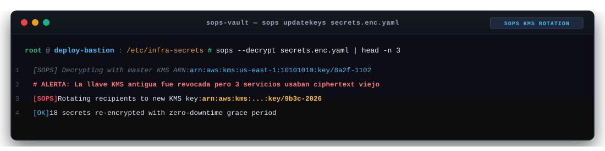

> [!WARNING] **Nota de confidencialidad y contexto:**  
> *Los nombres de organizaciones, proyectos, identificadores de red y credenciales han sido anonimizados por motivos de seguridad y confidencialidad operativa. La arquitectura técnica, la cronología de eventos, los comandos ejecutados, los diagnósticos y las lecciones aprendidas corresponden a un incidente real vivido en producción.*


---

En seguridad de infraestructura hay un principio que todo SRE aprende por las malas: **nunca destruyas una credencial antigua solo porque crees que ya nadie la usa; deja que la telemetría te demuestre que nadie la está llamando.**

A finales de septiembre iniciamos la rotación programada del usuario IAM `sops` en AWS. Este usuario posee los permisos de descifrado sobre las llaves de **AWS KMS** utilizadas por la herramienta **SOPS** (*Secrets OPerationS*) para cifrar todos los archivos de configuración (`values.yaml`, secretos de bases de datos, tokens de API) que gestionan nuestros clústeres de Kubernetes con GitOps (ArgoCD) y nuestros pipelines de CI/CD.

La rotación de la llave nueva en ArgoCD y en los flujos de integración continua fue un éxito impecable. Estábamos listos para eliminar la llave vieja en la consola de AWS.

Sin embargo, al ejecutar una última consulta de auditoría en **AWS CloudTrail**, la telemetría arrojó una sorpresa: **alguien del equipo había realizado 32 operaciones de descifrado con la llave vieja hacía menos de 18 horas desde una máquina portátil.**

---

## 1. El mapa de consumidores: la telaraña de SOPS





Antes de rotar una llave que cifra secretos de infraestructura es obligatorio construir un mapa exhaustivo de dependencias. En nuestra arquitectura, la llave KMS era consumida por:

1. **ArgoCD en producción y desarrollo:** El componente `repo-server` monta el secreto `aws-credentials` y ejecuta SOPS al vuelo para descifrar los manifiestos de Helm antes de aplicarlos en el clúster.
2. **Secretos de Organización en GitHub Actions:** Variables `SOPS_AWS_ACCESS_KEY_ID` inyectadas en 6 pipelines diferentes de despliegue continuo.
3. **Estaciones de trabajo de ingeniería:** Desarrolladores que ejecutan `sops -d secrets.yaml` localmente para modificar variables de entorno en sus ramas de trabajo.
4. **19 archivos de secretos cifrados en Git:** Archivos `values.yaml` en la rama `master` cuyos metadatos registraban el ARN de la clave KMS.

---

## 2. La regla de oro: Rotación en dos fases (*Add Before Remove*)

Para garantizar cero tiempo de inactividad, una rotación de credenciales nunca se hace reemplazando el valor en un solo paso destructivo:

```text
Fase 1: Generar Llave Nueva ──> Aprovisionar en Consumidores ──> Ventana de Coexistencia
                                                                        │
Fase 2: Validar en CloudTrail ──> Desactivar Llave Vieja ──> Esperar ──> Destruir
```

1. Se creó la `AccessKeyId` nueva (`AKIA...NEW`) manteniendo activa la antigua (`AKIA...OLD`).
2. Se actualizó el secreto en ArgoCD y se reinició el pod `argocd-repo-server`.
3. Se actualizaron los secretos de organización en GitHub Actions.
4. Se ejecutó un despliegue de prueba end-to-end en staging para comprobar que ArgoCD sincronizaba los cambios en estado `Synced`.

Todo parecía resuelto. La tentación de ejecutar `aws iam delete-access-key` era grande.

---

## 3. La sorpresa en CloudTrail: la llamada de las 19:04 UTC

Antes de pulsar el botón de borrado, ejecutamos una inspección de uso con AWS CLI:

```bash
$ aws iam get-access-key-last-used --access-key-id AKIA...OLD
{
    "UserName": "sops",
    "AccessKeyLastUsed": {
        "LastUsedDate": "2026-09-30T19:04:12+00:00",
        "ServiceName": "kms",
        "Region": "us-east-1"
    }
}
```

La llave vieja había sido utilizada **el día anterior a las 19:04 UTC**.

Consultamos los eventos crudos de auditoría en CloudTrail:

```bash
aws cloudtrail lookup-events   --lookup-attributes AttributeKey=AccessKeyId,AttributeValue=AKIA...OLD   --query "Events[*].[EventTime,EventName,SourceIPAddress,UserAgent]"   --output table
```

```text
-------------------------------------------------------------------------------------
|                                   LookupEvents                                    |
+----------------------+------------+------------------+----------------------------+
| 2026-09-30T19:04:12Z | Decrypt    | 198.51.100.25    | aws-sdk-go-v2/1.30.3 macOS |
| 2026-09-30T18:55:01Z | Decrypt    | 198.51.100.25    | sops/v3.9.0 (darwin/arm64) |
| 2026-09-30T18:40:22Z | DescribeKey| 198.51.100.25    | aws-cli/2.17.42 Python/3.11|
+----------------------+------------+------------------+----------------------------+
```

La telemetría fue concluyente:
- El `User-Agent` indicaba un binario SOPS compilado para arquitectura Apple Silicon (`darwin/arm64`).
- La IP pertenecía al túnel VPN de un desarrollador sénior del equipo.

Si hubiéramos destruido la llave inmediatamente, habríamos roto el entorno local del ingeniero a mitad de una tarea crítica de despliegue.

---

## 4. La comunicación y el cierre seguro

Contactamos al ingeniero: estaba preparando un hotfix en una rama local y su archivo `~/.aws/credentials` seguía apuntando al perfil con la clave vieja.

El protocolo de cierre se ejecutó de forma ordenada:
1. El ingeniero actualizó sus credenciales locales a la llave nueva.
2. En lugar de borrar la llave en AWS, **la cambiamos a estado inactivo (`Inactive`)**:
   ```bash
   aws iam update-access-key --access-key-id AKIA...OLD --status Inactive --user-name sops
   ```
3. Se mantuvo en cuarentena durante 72 horas. Si algún proceso oculto hubiera fallado, reactivarla habría tomado dos segundos.
4. Tras tres días con cero intentos de acceso fallidos en CloudTrail, se procedió a la destrucción física de la credencial:
   ```bash
   aws iam delete-access-key --access-key-id AKIA...OLD --user-name sops
   ```

---

## 5. Lecciones aprendidas

1. **`get-access-key-last-used` es tu salvavidas:** Antes de borrar cualquier credencial en AWS, revisa siempre cuándo y desde qué servicio fue invocada por última vez.
2. **CloudTrail no miente:** El User-Agent en los eventos de CloudTrail te dice con exactitud si quien llama es un pod de Kubernetes, un runner de GitHub Actions o la laptop de un compañero de equipo.
3. **Desactiva antes de eliminar:** El estado `Inactive` en IAM es una red de seguridad gratuita. Una llave inactiva no puede usarse, pero te permite dar marcha atrás en segundos si descubres una dependencia huérfana de madrugada.
