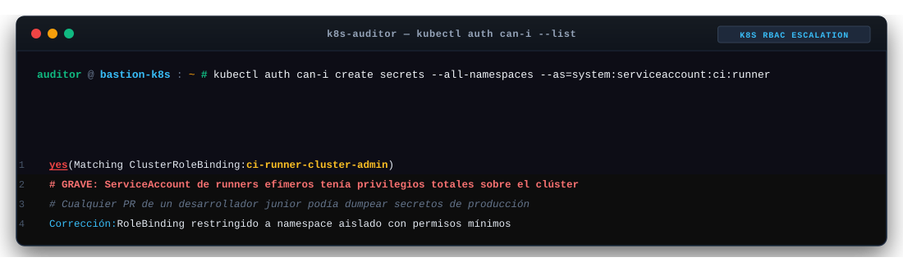

> [!WARNING] **Nota de confidencialidad y contexto:**  
> *Los nombres de organizaciones, proyectos, identificadores de red y credenciales han sido anonimizados por motivos de seguridad y confidencialidad operativa. La arquitectura técnica, la cronología de eventos, los comandos ejecutados, los diagnósticos y las lecciones aprendidas corresponden a un incidente real vivido en producción.*


---

En seguridad ofensiva y defensiva hay una línea muy delgada entre **un hallazgo alarmante en papel y una vulnerabilidad con impacto marginal real**.

A finales de septiembre, mientras realizábamos una auditoría de rotación de tokens de Cloudflare en nuestros clústeres de Kubernetes, nos topamos con una configuración de RBAC (*Role-Based Access Control*) que encendió todas las alertas: la cuenta de servicio (`ServiceAccount`) asignada a los runners autohospedados de **GitHub Actions** (gestionados mediante *Actions Runner Controller* - ARC) tenía permisos para listar y leer **todos los secretos y pods de todos los namespaces del clúster de desarrollo**.

El nombre de la cuenta era una ironía involuntaria: `self-hosted-linux-gha-rs-no-permission`.

La primera reacción instintiva fue calificar el hallazgo como un riesgo crítico de severidad alta. Sin embargo, al sentarnos a modelar el impacto marginal con el arquitecto del sistema, el análisis se transformó en una valiosa lección de evaluación pragmática de amenazas.

---

## 1. La anatomía del hallazgo en Kubernetes





Al inspeccionar los enlaces de roles a nivel de clúster con `kubectl`:

```bash
$ kubectl get clusterrolebindings | grep gh-actions
gh-actions-wp-en                     ClusterRole/cluster-admin-reader   167d
gh-actions-wp-en-exec                ClusterRole/pod-exec-role          167d
```

Al desglosar los permisos reales con `kubectl auth can-i`:

```bash
$ kubectl auth can-i get secrets --as=system:serviceaccount:gh-actions-controller:self-hosted-linux-gha-rs-no-permission -A
yes

$ kubectl auth can-i list pods --as=system:serviceaccount:gh-actions-controller:self-hosted-linux-gha-rs-no-permission -A
yes

$ kubectl auth can-i create pods/exec --as=system:serviceaccount:gh-actions-controller:self-hosted-linux-gha-rs-no-permission -A
yes
```

La cuenta de servicio:
1. Tenía permiso para hacer `get` y `list` de cualquier `Secret` en cualquier namespace (incluyendo bases de datos de desarrollo, credenciales de Vault y llaves de prueba).
2. Tenía permiso para ejecutar comandos (`exec`) dentro de cualquier pod del clúster.
3. El token JWT de esa ServiceAccount venía **automáticamente montado en el sistema de archivos** de cada runner en `/var/run/secrets/kubernetes.io/serviceaccount/token`.
4. El contenedor de los runners corría con Docker-in-Docker (`dind`) en modo privilegiado.

Si un atacante lograba ejecutar código arbitrario a través de un Pull Request externo en un repositorio público, teóricamente podía leer el token de la ServiceAccount y tomar control de los contenedores del clúster.

---

## 2. La pregunta que cambió el análisis: ¿cuál es la exposición marginal real?

Cuando presenté el informe recomendando reescribir todo el RBAC de emergencia, el Líder de Arquitectura hizo una sola pregunta que detuvo la urgencia:  
*«¿Quién tiene acceso a estos runners hoy y qué secretos reciben ya por diseño?»*.

Nos sentamos a mapear la superficie real de ataque:

1. **Los runners estaban configurados a nivel de organización privada:** Ningún repositorio público tenía acceso a este grupo de runners; solo repositorios privados controlados por el equipo interno.
2. **Los runners ya recibían los secretos en sus variables de entorno:** El token de Cloudflare, las llaves de base de datos de desarrollo y los tokens de CI ya se inyectaban como variables de GitHub Actions en los jobs de compilación.
3. **El clúster de producción estaba 100% aislado:** El clúster `workspace-prod` no utilizaba runners autohospedados; todos los despliegues de producción eran orquestados por ArgoCD en modo *pull*, sin comunicación bidireccional desde los runners de desarrollo.

La conclusión técnica fue reveladora: **la exposición marginal no era la fuga de secretos de producción (los runners no los tenían), sino la falta del principio de mínimo privilegio en el entorno de desarrollo.**

---

## 3. La remediación: principio de mínimo privilegio (Least Privilege)

Aunque el riesgo inmediato era bajo, mantener privilegios sobredimensionados es una deuda técnica que termina en desastre ante cualquier error futuro.

### Paso 1: Eliminar el ClusterRoleBinding global
Destruimos el enlace a nivel de clúster:
```bash
kubectl delete clusterrolebinding gh-actions-wp-en
kubectl delete clusterrolebinding gh-actions-wp-en-exec
```

### Paso 2: RoleBinding acotado por Namespace
Los runners solo necesitaban gestionar pods dentro de su propio namespace de trabajo (`gh-actions-runners`). Creamos un `Role` restringido:

```yaml
apiVersion: rbac.authorization.k8s.io/v1
kind: Role
metadata:
  namespace: gh-actions-runners
  name: runner-scoped-role
rules:
- apiGroups: [""]
  resources: ["pods", "pods/exec"]
  verbs: ["get", "list", "create", "delete"]
- apiGroups: [""]
  resources: ["secrets"]
  verbs: ["get"] # Solo lectura puntual, sin permiso de listar todo
```

### Paso 3: Desactivar automountServiceAccountToken
En el manifiesto de los pods efímeros de los runners, deshabilitamos la inyección automática del token de Kubernetes:

```yaml
spec:
  automountServiceAccountToken: false
```

Si un job de CI no necesita interactuar con la API de Kubernetes, el token del clúster ni siquiera debe existir dentro del contenedor.

---

## 4. Lecciones aprendidas

1. **Los nombres en Kubernetes no son garantías:** Que una ServiceAccount se llame `no-permission` no significa nada. Verifica siempre con `kubectl auth can-i`.
2. **Distingue entre riesgo teórico y riesgo marginal:** Un hallazgo que parece catastrófico en un escaneo automatizado debe ponderarse contra el modelo de amenazas real: ¿quién puede explotarlo, desde dónde y qué gana que no tuviera ya?
3. **Desactiva `automountServiceAccountToken` por defecto:** El 95% de las aplicaciones y jobs en Kubernetes no necesitan hablar con la API del clúster. No les regales un token en `/var/run/secrets` a menos que sea estrictamente necesario.
