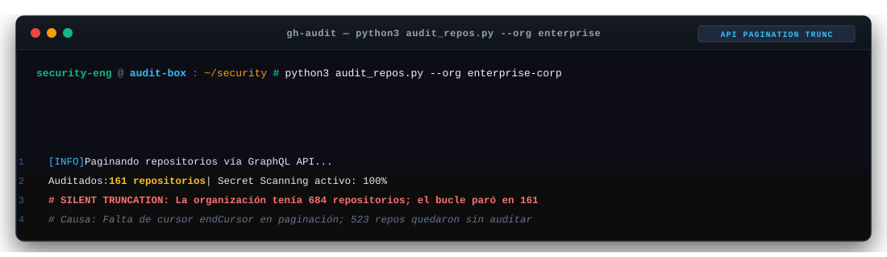

> [!WARNING] **Nota de confidencialidad y contexto:**  
> *Los nombres de organizaciones, proyectos, identificadores de red y credenciales han sido anonimizados por motivos de seguridad y confidencialidad operativa. La arquitectura técnica, la cronología de eventos, los comandos ejecutados, los diagnósticos y las lecciones aprendidas corresponden a un incidente real vivido en producción.*


---

En automatización de seguridad hay un axioma fundamental: **nunca confíes en el código de salida `0` de un script si no has validado contra una fuente de verdad independiente cuántos elementos debían ser procesados.**

Este incidente se originó a raíz de la auditoría del token de Packagist que descubrimos expuesto en texto plano semanas atrás. Como medida preventiva institucional, la dirección de ingeniería emitió una directriz prioritaria:  
*«Activar Secret Scanning y Push Protection en absolutamente todos los repositorios de la organización en GitHub»*.

Un ingeniero de infraestructura escribió un script con el CLI oficial de GitHub (`gh`), lo ejecutó en su terminal y reportó en el canal de operaciones:  
*«Listo, protección activada en todos los repositorios»*.

Apenas doce horas después, un bot automatizado de auditoría interna de QA reabrió la tarea con un mensaje lapidario: **solo 161 repositorios tenían la protección activa. La organización tenía en realidad 684 repositorios.**

---

## 1. La trampa silenciosa de `gh repo list`





Al examinar el script original que ejecutó la primera pasada:

```bash
#!/usr/bin/env bash
# Script inicial con defecto de truncado
for repo in $(gh repo list mi-organizacion --json nameWithOwner -q '.[].nameWithOwner'); do
    echo "Habilitando protección en $repo..."
    gh api -X PATCH "repos/$repo" -f security_and_analysis[secret_scanning][status]=enabled
    gh api -X PATCH "repos/$repo" -f security_and_analysis[secret_scanning_push_protection][status]=enabled
done
```

A simple vista, el script recorre todos los repositorios devueltos por el comando `gh repo list`.

El problema técnico es que **`gh repo list` tiene un límite de paginación predeterminado de 200 resultados**. 

Si una organización tiene más de 200 repositorios, el comando **no arroja ningún error, no emite ninguna advertencia y no informa que la lista ha sido truncada**. Simplemente devuelve los primeros registros y termina con código de salida `0`.

Como la organización contaba con 684 repositorios (237 activos y 447 archivados), el script solo procesó una pequeña fracción y dejó a ciegas al 75% del código de la empresa.

---

## 2. El bot de QA que no acepta suposiciones

El héroe involuntario de este incidente fue nuestro bot interno de aseguramiento de calidad (*Workspace Agent*). 

El bot corre periódicamente en GitHub Actions y compara el estado deseado de las directivas de seguridad contra la API de GitHub:

```text
[AUDIT REPORT - SECRET SCANNING]
Total repos en organización: 684
Repositorios con Push Protection habilitado: 161
Repositorios desprotegidos: 523
ESTADO: FAILED - REABRIENDO TICKET DE SEGURIDAD
```

El bot detectó la discrepancia matemática de inmediato.

---

## 3. La segunda vuelta: el dilema de los repositorios archivados y los forks

Al corregir el parámetro de límite a `--limit 1000` para abarcar el universo real:

```bash
gh repo list mi-organizacion --limit 1000 --json isArchived,isFork,nameWithOwner
```

Aparecieron dos casos de borde que complicaron la ejecución:

### 1. Repositorios Archivados (`isArchived: true`)
En GitHub, un repositorio archivado está congelado en modo de solo lectura. Si intentas habilitar *Push Protection* mediante la API de GitHub:
```json
{{
  "message": "Repository was archived so is read-only.",
  "documentation_url": "https://docs.github.com/rest/repos/repos#update-a-repository"
}}
```
La llamada a la API devuelve `HTTP 403 Forbidden`. Por diseño de la plataforma, un repositorio archivado no puede recibir pushes, por lo que el riesgo de fuga activa de secretos es nulo.

### 2. Forks públicos de herramientas de código abierto
La organización mantenía dos forks públicos de librerías externas de inteligencia artificial. En la primera clasificación se pensó en aplicarles únicamente *Secret Scanning* (solo lectura) y no *Push Protection* para no interferir con las contribuciones upstream.

El bot de QA volvió a levantar la mano: tener una política diferenciada en repositorios públicos aumentaba el riesgo asimétrico. Si un desarrollador empujaba una rama con un secreto a un fork público, el daño era inmediato e irreparable.

---

## 4. La solución definitiva: script idempotente y cobertura al 100%

Diseñamos un script robusto que filtra por estado de archivo, maneja límites de rate limit en la API y verifica cada cambio:

```bash
#!/usr/bin/env bash
set -euo pipefail

ORG="mi-organizacion"
echo "Obteniendo universo completo de repositorios para $ORG..."

# Paginación completa con límite explícito alto
REPOS=$(gh repo list "$ORG" --limit 2000 --no-archived --json nameWithOwner -q '.[].nameWithOwner')

TOTAL=$(echo "$REPOS" | wc -l)
echo "Total de repositorios activos a proteger: $TOTAL"

COUNT=0
for repo in $REPOS; do
    COUNT=$((COUNT + 1))
    echo "[$COUNT/$TOTAL] Configurando protección en: $repo"
    
    gh api --silent -X PATCH "repos/$repo"       -F "security_and_analysis[secret_scanning][status]=enabled"       -F "security_and_analysis[secret_scanning_push_protection][status]=enabled" || {{
        echo "[!] Error al configurar $repo" >&2
      }}
done

echo "[OK] Cobertura completada exitosamente en los $TOTAL repositorios activos."
```

Al volver a ejecutar la auditoría del bot de QA:
```text
[AUDIT REPORT - SECRET SCANNING]
Repositorios activos evaluados: 237
Cobertura Push Protection: 100% (237/237)
ESTADO: COMPLIANT - TICKET CERRADO
```

---

## 5. Lecciones aprendidas

1. **Cuidado con los defaults de las herramientas CLI:** Muchas herramientas de línea de comandos (`gh`, `aws`, `kubectl`) truncan resultados o devuelven las primeras 50/100 filas por defecto para no saturar la terminal. En scripts de automatización, pasa siempre parámetros explícitos de límite o maneja paginación con cursores.
2. **Los bots de reconciliación son indispensables:** La automatización humana comete errores de alcance. Un bot independiente que audita la infraestructura contra la realidad sin sesgos es la mejor garantía de gobernanza.
3. **Reglas simples y universales superan a políticas complejas:** Intentar categorizar qué repositorios merecen protección completa y cuáles solo escaneo básico creó fricciones y huecos de seguridad. Proteger el 100% de los repositorios activos de forma uniforme eliminó el debate y cerró el riesgo.
