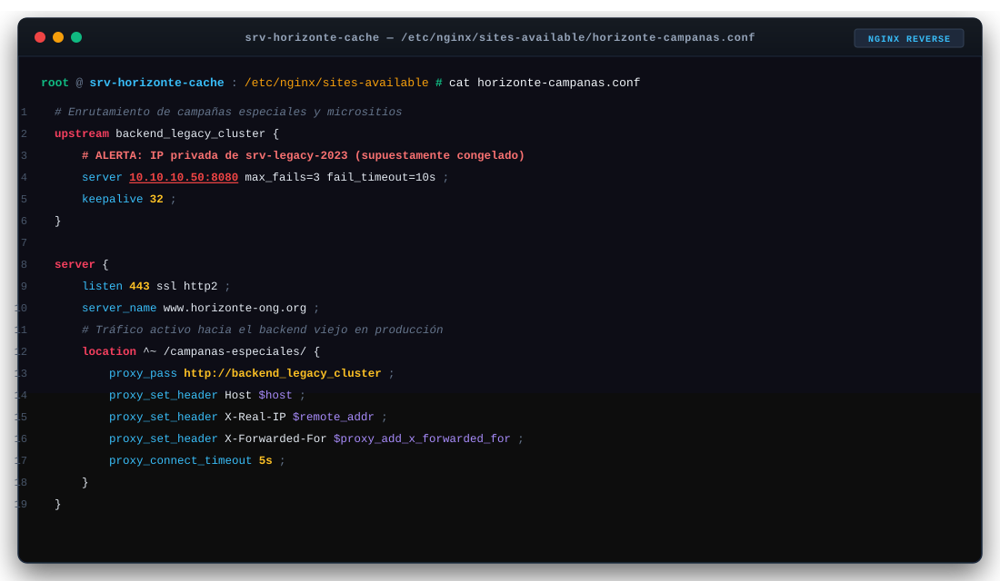

> [!WARNING] **Nota de confidencialidad y contexto:**  
> *Los nombres de organizaciones, proyectos, identificadores de infraestructura y direcciones IP han sido anonimizados por motivos de seguridad y confidencialidad operativa. La arquitectura técnica, la secuencia de eventos, los comandos ejecutados, los diagnósticos y las lecciones aprendidas corresponden a un incidente real vivido en producción.*

---

Hay frases en operaciones que deberían encender alarmas de inmediato. Una de las más peligrosas es:  
*«Tranquilos, ese servidor viejo ya está congelado, no hace nada»*.

En este caso particular, estábamos trabajando con una organización no gubernamental de alto impacto que llamaremos **Proyecto Horizonte**. Un par de meses atrás, su infraestructura principal había sufrido una intrusión severa que escaló hasta privilegios de `root`. La respuesta inicial del equipo en aquel momento fue contener la amenaza, desplegar un servidor limpio de producción y dejar la máquina antigua en cuarentena: supuestamente aislada, sin tráfico y a la espera de ser archivada.

La sorpresa vino semanas después, cuando una tarea rutinaria de migración de contenidos nos puso de frente con una realidad incómoda: **el servidor no estaba congelado, seguía sirviendo tráfico legítimo de usuarios, tenía acceso sin restricciones a la base de datos de producción y hospedaba un backdoor activo que nadie había visto.**

Esta es la crónica de cómo descubrimos la brecha, los errores de diagnóstico en el camino y por qué una limpieza superficial de archivos nunca reemplaza a una reconstrucción forense completa.

---

## 1. El pecado original: la falsa sensación de contención

Para entender el problema hay que retroceder a la primera intrusión (la llamaremos la fase inicial). Los atacantes entraron a través de una vulnerabilidad en la aplicación web WordPress:

1. **Creación de administradores fantasma:** Apareció un usuario administrador no autorizado (`support@wordpress-sys.org`), seguido 48 horas después por un segundo admin falso.
2. **Escalación a root:** Apenas 45 minutos después del primer usuario, el atacante logró compilar y desplegar un binario ELF estático con dueño `root` en el sistema de archivos del servidor.
3. **Persistencia mediante C2:** Se instaló un kit de webshell CGI y herramientas de canal inverso (C2 mediante `gsocket`) camufladas bajo nombres de hilos legítimos del kernel como `[card0-crtc8]` y `[kcached]`.

En ese momento se ejecutó una respuesta de emergencia. Se limpiaron las webshells detectadas, se borraron los usuarios administradores maliciosos, se aisló evidencia y se documentó una advertencia técnica fundamental en el informe:

> *«Limpiar archivos web NO remedia un compromiso a nivel root. Mientras un proceso o backdoor con privilegios elevados siga vivo en el sistema operativo, los archivos se pueden reinfectar en cualquier instante».*

Para mitigar el riesgo, se aprovisionó una máquina virtual nueva (`srv-horizonte-prod`) y se apuntaron las rutas principales allí. El servidor vulnerado (`srv-legacy-2023`) quedó caratulado en la documentación interna como **"congelado"**.

Y ahí fue donde bajamos la guardia.

---

## 2. El descubrimiento: tirar de un hilo y encontrar una maraña

Semanas más tarde, se nos asignó una tarea técnica aparentemente tranquila: migrar seis micrositios institucionales de campañas especiales (campañas históricas alojadas bajo la ruta `/campanas-especiales/*`) hacia el servidor nuevo para poder, finalmente, dar de baja la máquina vieja en el proveedor de cloud.

Al entrar a auditar el flujo de red para planificar el corte, algo no cuadraba:

```bash
$ ps aux | grep apache2
root      1428  0.0  1.2  ... /usr/sbin/apache2 -k start (running since Jun 23)
www-data  1435  0.1  2.4  ... /usr/sbin/apache2 -k start
```

Apache llevaba semanas corriendo sin pausa. Al rastrear la configuración del proxy inverso NGINX que estaba delante de la arquitectura (`srv-horizonte-cache`), descubrimos la cadena real de servicio:



El servidor comprometido **no solo no estaba congelado**: era el backend activo que procesaba todo el tráfico de las campañas especiales institucionales, con certificados TLS vigentes y sirviendo peticiones a diario.

Y la auditoría de red empeoró rápidamente:
- **Exposición pública directa:** Las reglas de `ufw` en `srv-legacy-2023` tenían los puertos 80 y 443 abiertos a `0.0.0.0/0`. Cualquiera que conociera la IP pública del servidor podía saltarse Cloudflare y atacarlo directamente.
- **Acceso irrestricto a la base de datos:** Al revisar el firewall del servidor de base de datos (`srv-horizonte-db`), encontramos una línea reveladora:
  ```text
  [ 4] 3306/tcp ALLOW IN 10.10.10.50    # (sin comentario)
  ```
  Todas las reglas legítimas del firewall tenían comentarios indicando a qué nodo pertenecían (`# Prod Web`, `# Staging`). Esta regla no tenía comentario alguno: **el servidor comprometido tenía vía libre para consultar y modificar la base de datos de producción.**

```architecture
cadena-servicio-y-amenazas
```

---

## 3. La migración: cuando la teoría choca con el tráfico real

Para apagar la máquina infectada no podíamos simplemente apagar el switch: primero había que rescatar esos seis micrositios y moverlos al servidor nuevo (`srv-horizonte-prod`).

Montamos un nuevo repositorio para las campañas especiales, replicamos el entorno en el nuevo servidor bajo PHP 8.2/8.3 y realizamos el cambio en Cloudflare eliminando el worker que enrutaba hacia el proxy viejo. En los logs de Apache de `srv-legacy-2023`, las peticiones cayeron a cero.

Pero el tráfico real nunca perdona las suposiciones. Inmediatamente después del corte, el micrositio más importante (`/campanas-especiales/30-anos-conmemoracion`) comenzó a responder con errores **404 Not Found**.

### Las pistas falsas

Aquí es donde entra la realidad de la trinchera técnica: **no siempre das con la causa a la primera.**
1. **Primera hipótesis:** Pensamos que era un problema del módulo de reescritura de Apache (`mod_rewrite`) o una directiva en el `.htaccess` que no coincidía con la estructura del VirtualHost. Probamos ajustes de reescritura. Seguía dando 404.
2. **Segunda hipótesis:** Sospechamos de plugins de redirección forzada SSL (como Really Simple SSL) interfiriendo con la terminación TLS de Cloudflare. Se deshabilitaron reglas. Nada.
3. **Tercera hipótesis:** Caché estancada de NGINX o Cloudflare devolviendo respuestas cacheadas viejas. Se purgó toda la caché. El 404 persistía.

### El hallazgo en los headers

Decidí mirar las cabeceras HTTP crudas que devolvía la petición:

```http
HTTP/1.1 404 Not Found
Date: Tue, 05 Aug 2026 18:02:11 GMT
Server: Apache/2.4.52 (Ubuntu)
Link: <https://www.horizonte-ong.org/wp-json/>; rel="https://api.w.org/"
```

Ese header `Link` fue la clave: el micrositio de campaña especial estaba apuntando al `wp-json` **del sitio principal**, no al suyo.

**¿Por qué?**  
El servidor nuevo usaba `mod_php`. El sitio principal inyectaba sus variables de entorno de producción directamente en el proceso global de Apache. El micrositio utilizaba una versión antigua de `vlucas/phpdotenv` (v2), cuya función `load()` tiene una peculiaridad: **por defecto no sobrescribe variables de entorno que ya existan en el proceso.**

Por lo tanto, cuando el micrositio intentaba leer `DB_NAME` y `DB_USER` desde su propio archivo `.env`, PHP leía las variables del sitio principal que ya estaban presentes en la memoria de Apache. El micrositio se conectaba a la base de datos equivocada, no encontraba sus tablas de contenido y lanzaba un 404 limpio.

La solución fue forzar la sobreescritura mediante `putenv()` iterando las variables del archivo `.env` local. Además, nos topamos con un tropiezo adicional: `parse_ini_file()` no elimina automáticamente comillas simples en strings con caracteres especiales, por lo que una contraseña con comillas generó un error 500 temporal hasta que se sanitizó el parser. 

Diagnosticar esto requirió humildad: dejar de teorizar sobre capas complejas de caché y simplemente inspeccionar qué estaba viendo el código en memoria con `getenv()`.

---

## 4. El análisis forense: el backdoor que seguía respirando

Con los micrositios a salvo en el servidor nuevo y el tráfico redirigido, procedimos a cortar el acceso de red:
- Se eliminó el `proxy_pass` en NGINX.
- Se borró la regla huérfana de MySQL en el firewall de la base de datos.
- Se realizó un volcado offline de los discos para análisis forense antes de cualquier apagado.

El 11 de agosto realizamos una auditoría de solo lectura sobre el sistema de archivos del servidor viejo. Y ahí encontramos el verdadero peligro:

```bash
# ls -la /usr/local/bin/uptime_check
-rwxr-xr-x 1 root root 1248592 Jun 17 11:55 /usr/local/bin/uptime_check

# md5sum /usr/local/bin/uptime_check
c9dde165f1c6c48a5e8c7fff60e7a6bd  /usr/local/bin/uptime_check
```

Un binario estático ELF, propiedad de `root`, creado el **17 de junio a las 11:55 UTC** (apenas 45 minutos después de que se creara el primer usuario web fraudulento). 

Al revisar la persistencia del sistema operativo:

```ini
# cat /etc/systemd/system/uptime_checker.service
[Unit]
Description=System Uptime Checker Daemon
After=network.target

[Service]
Type=simple
ExecStart=/usr/local/bin/uptime_check
Restart=always
RestartSec=5

[Install]
WantedBy=multi-user.target
```

Un servicio de `systemd` configurado con `Restart=always`.

Al inspeccionar los sockets abiertos:

```bash
# ss -tulpn | grep 5000
tcp   LISTEN 0      128    0.0.0.0:5000   0.0.0.0:*   users:(("uptime_check",pid=912,fd=3))
```

El proceso **seguía corriendo**. Llevaba casi dos meses escuchando silenciosamente en el puerto 5000 en todas las interfaces de red.

Al ejecutar `strings` sobre el ejecutable encontramos llamadas directas a la API del kernel:
- `socket`, `bind`, `listen`, `accept`
- `execve`, `execvpe`, `fork`, `dup2`
- Rutinas de evasión de logs y decodificación XOR de comandos.

Adicionalmente, el firewall tenía una regla de salida hacia una IP externa (`174.138.59.x:443`) que resolvía falsamente hacia un subdominio de actualización de plugins conocidos: un canal de comando y control (C2) diseñado para confundirse con tráfico legítimo de administración web.

Este backdoor no estaba en los registros de la primera limpieza. Ningún escáner de plugins de WordPress lo detectó porque no estaba en `wp-content`, sino anclado en `systemd` como un servicio del sistema operativo.

---

## 5. Lecciones aprendidas en la trinchera

El servidor fue finalmente destruido desde el panel del proveedor de infraestructura tras una ventana de observación controlada. De este incidente nos quedaron lecciones que transformaron nuestros procedimientos de SRE y seguridad:

1. **«Congelado» no es un estado técnico:** Si un servidor está documentado como congelado pero sus interfaces de red siguen arriba y sus procesos siguen corriendo, está en producción. Si una máquina ya no debe operar, se apaga la interfaz de red o se apaga la instancia.
2. **Las limpiezas web no curan intrusiones root:** Si un atacante llegó a `root`, el kernel y los binarios del sistema operativo ya no son confiables. La única remediación válida tras un compromiso root es la **destrucción y reemplazo completo del nodo**. Tratar de "limpiar archivos" deja puertas traseras vivas el 90% de las veces.
3. **Las reglas de firewall huérfanas son banderas rojas:** Una regla en `iptables` o `ufw` sin comentario explicativo no es un descuido estético: es una anomalía de seguridad que debe auditarse inmediatamente.
4. **Cuidado con las variables de entorno compartidas:** Cuando múltiples aplicaciones web conviven bajo el mismo proceso web (`mod_php`), las variables inyectadas a nivel global pueden colisionar de formas silenciosas y desconcertantes.
5. **No asumas la causa de un fallo sin mirar los datos crudos:** Pasamos horas revisando rewrites y cachés cuando la respuesta estaba en una sola cabecera HTTP que delataba una conexión cruzada de base de datos.
