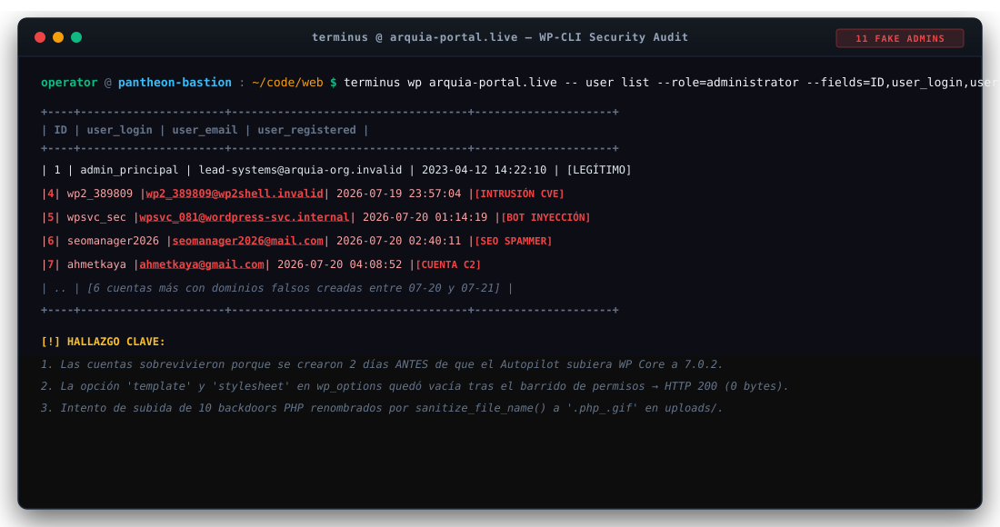

> [!WARNING] **Nota de confidencialidad y contexto:**  
> *Los nombres de organizaciones, proyectos, identificadores de red y credenciales han sido anonimizados por motivos de seguridad y confidencialidad operativa. La arquitectura técnica, la cronología de eventos, los comandos ejecutados, los diagnósticos y las lecciones aprendidas corresponden a un incidente real vivido en producción.*

---

En soporte de producción hay problemas que entran disfrazados de inconvenientes menores de frontend. Un lunes por la mañana recibimos un ticket reportando que el portal público de una institución gremial educativa —a la que llamaremos **Proyecto Arquia**— no cargaba.

Al abrir la URL en el navegador nos encontramos con el escenario más desconcertante de la web: una **pantalla totalmente en blanco**. Ni error 500, ni pantalla de mantenimiento, ni advertencias de base de datos. Una respuesta limpia de `HTTP 200 OK` con un cuerpo exacto de `0 bytes`.

Lo que en un primer momento parecía un problema de caché o una plantilla desconfigurada tras una actualización, terminó siendo la fase final de una intrusión masiva a nivel global explotando la vulnerabilidad **wp2shell**. Los atacantes llevaban más de un mes dentro del sistema, habían sembrado 11 cuentas de administrador no autorizadas y estaban a punto de tomar control total del servidor.

Esta es la autopsia técnica de la investigación, el laberinto de la pista falsa que casi nos hace perder el rumbo y cómo la remediamos de raíz.

---

## 1. La anatomía del ataque: cómo ocurrió la brecha silenciosa

Para entender por qué el sitio quedó en blanco, tuvimos que reconstruir la cronología forense cruzando los commits del repositorio Git, los registros de auditoría de la plataforma cloud (Pantheon) y la base de datos de producción:

```timeline
cronologia-ataque-wp2shell
```

### El vector: wp2shell
A mediados de julio se hizo pública una de las vulnerabilidades más destructivas del ecosistema WordPress: una combinación de **confusión de rutas en la REST API** encadenada con una **inyección SQL sin autenticación**. El resultado era ejecución remota de código (RCE) directa.

Los atacantes actuaron en cuestión de horas. A través de bots automatizados, atacaron la API e insertaron directamente en la tabla `wp_users` una serie de cuentas con privilegios de administrador:



### La falsa sensación de tranquilidad del parche automático
Cuatro días después de la intrusión, el sistema de actualización automática de dependencias (*Autopilot*) se ejecutó según su cron semanal, actualizó el núcleo de WordPress a la versión `7.0.2` corregida y se dio por cerrado el aviso de seguridad en los tableros internos.

Aquí estuvo el primer fallo operativo: **cerrar la vulnerabilidad no expulsó a los atacantes**. Las 11 cuentas de administrador ya estaban registradas y activas en la base de datos. La puerta trasera estaba abierta por dentro.

---

## 2. La pista falsa: cuando un bug normal se esconde en el incidente

Cuando intenté acceder al panel de administración `/wp-admin/` con mi usuario legítimo para inspeccionar los plugins, la pantalla arrojó el temido mensaje:  
*«Ha habido un error crítico en esta web»*.

La reacción instintiva en medio de un incidente de seguridad es asumir que **todo** lo que falla es obra del atacante. Pensamos inmediatamente: *«bloquearon el acceso a los administradores legítimos»*.

Al revisar los logs de error de PHP en el servidor:

```text
Fatal error: Uncaught TypeError: gmdate(): Argument #2 ($timestamp) must be of type ?int, string given 
in /code/web/wp-content/plugins/bb-ultimate-addon/classes/class-uabb-cloud-templates.php:148
```

Era un simple error tipado de **PHP 8.3**. Una opción en la base de datos (`uabb_cloud_templates`) contenía un string vacío en lugar de un entero, provocando que `gmdate()` rompiera la ejecución en cada carga del admin.

No tenía nada que ver con el ataque: era un bug de compatibilidad latente de un plugin de maquetación que coincidió con el momento crítico. Corregirlo fue tan simple como ejecutar:

```bash
terminus wp arquia-portal.live -- option delete uabb_cloud_templates
```

Con esa sola línea el acceso a `/wp-admin/` volvió. Si hubiéramos perdido horas teorizando sobre un supuesto bloqueo malicioso en el código de autenticación, habríamos retrasado la respuesta real. En incidentes graves, aislar el ruido es el 50% del éxito.

---

## 3. La causa real de la página en blanco: bisección de backups

¿Por qué el sitio público entregaba 0 bytes?

Audité el historial de Git del repositorio y confirmamos que no había habido ningún despliegue de código en las últimas dos semanas. El código en disco estaba intacto. Por lo tanto, **el daño estaba en la base de datos**.

Utilizando los backups diarios de la base de datos en Pantheon, realizamos una **bisección retrospectiva**:
- Backup del 21 de agosto: el sitio renderizaba correctamente.
- Backup del 27 de agosto: el sitio devolvía 0 bytes.

Al comparar el diff de la tabla `wp_options` entre ambos volcados, el misterio se resolvió:

```sql
-- Valores legítimos (21 de agosto):
template = 'bb-theme'
stylesheet = 'bb-theme-child'
current_theme = 'Arquia Custom Theme'

-- Valores tras el ataque (27 de agosto):
template = ''
stylesheet = ''
current_theme = ''
```

El 25 de agosto, los atacantes utilizaron uno de los administradores fantasma para iniciar sesión desde una IP de Azure (`52.190.192.x`). Durante una ventana de 70 minutos ejecutaron un escaneo automático intentando subir plugins, editar temas y modificar archivos. Al encontrarse con que el sistema de archivos de Pantheon en producción es de **solo lectura** por diseño (lo cual bloqueó la subida de webshells ejecutables), el script del atacante forzó una escritura en la base de datos que vació las opciones del tema activo.

Al no existir tema asignado, el motor de WordPress no tenía qué renderizar: cargaba el core en memoria, devolvía código 200 y finalizaba con un buffer vacío.

---

## 4. Los archivos fantasma: cómo WordPress neutralizó los backdoors

Durante la revisión forense del directorio de medios (`wp-content/uploads/`) descubrimos algo fascinante: 10 archivos sospechosos en las carpetas de julio y agosto con extensiones extrañas:

```text
wp-content/uploads/2026/07/wp-cache-core.php_.gif
wp-content/uploads/2026/08/session-cache-db.php_.gif
```

El atacante intentó subir backdoors PHP camuflados como falsos plugins de caché. Sin embargo, la función interna `sanitize_file_name()` de WordPress detectó la manipulación de nombres y renombró los archivos agregando la extensión `.gif` al final, convirtiéndolos en archivos inertes que NGINX nunca ejecutaría como código PHP.

El atacante creía que sus puertas traseras estaban operativas e intentó llamarlas mediante peticiones automatizadas (selftest pings), pero todas recibieron un error 404. La defensa en profundidad de la plataforma funcionó.

---

## 5. Remediación paso a paso

Una vez confirmado el vector y el alcance, ejecutamos un plan de remediación integral:

1. **Eliminación quirúrgica de administradores fantasma:**  
   Se eliminaron las 11 cuentas no autorizadas tanto en el entorno `live` como en el de `test` mediante WP-CLI:
   ```bash
   terminus wp arquia-portal.live -- user delete 4 5 6 7 8 9 10 11 12 13 14 --reassign=1 --yes
   ```
2. **Restauración de opciones de tema:**  
   Reasignamos el tema padre y tema hijo en la base de datos y limpiamos la caché del Edge:
   ```bash
   terminus wp arquia-portal.live -- option update template 'bb-theme'
   terminus wp arquia-portal.live -- option update stylesheet 'bb-theme-child'
   terminus env:clear-cache arquia-portal.live
   ```
3. **Invalidación total de sesiones:**  
   Se destruyeron todas las cookies y tokens de sesión existentes para obligar a una reautenticación limpia de usuarios legítimos:
   ```bash
   terminus wp arquia-portal.live -- eval 'foreach (get_users() as $u) { WP_Session_Tokens::get_instance($u->ID)->destroy_all(); }'
   ```
4. **Purga de archivos neutralizados:** Se eliminaron los 10 archivos `.php_.gif` huérfanos del directorio de subidas.
5. **Auditoría horizontal a nivel de organización:**  
   Ese mismo día ejecutamos un script automatizado sobre los **17 sitios web adicionales** de la organización en Pantheon para buscar firmas de wp2shell. Ningún otro sitio tenía administradores comprometidos.

---

## 6. Lecciones que nos dejó este incidente

1. **Un bug de página en blanco no siempre es un fallo de código:** Puede ser el residuo destructivo de un atacante frustrado por no haber podido escribir en disco.
2. **La bisección de backups es una máquina del tiempo invaluable:** Sin backups diarios retenidos, habría sido imposible determinar la ventana exacta de 6 días en la que se alteró la tabla `wp_options`.
3. **Las actualizaciones automáticas no bastan si ya hubo intrusión:** Si un parche llega 4 días después del inicio de una campaña masiva de explotación, asumir que el sitio está seguro sin auditar tablas de usuarios es una negligencia operativa.
4. **No mezcles bugs cotidianos con el incidente:** El `TypeError` en PHP 8.3 parecía un sabotaje deliberado y terminó siendo un fallo menor de formato. Calma, logs y verificación empírica.
