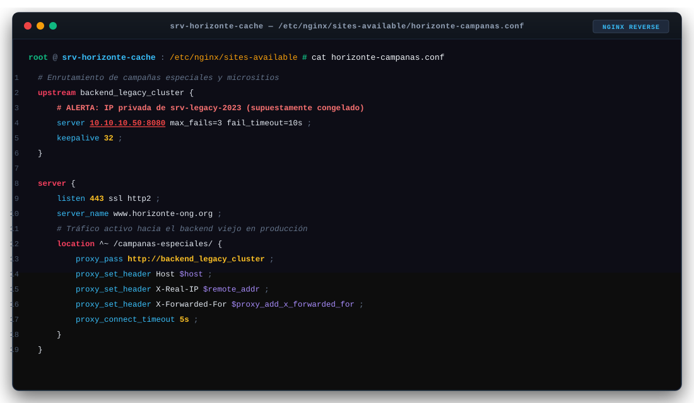

# Guía de Ilustraciones Vectoriales de Terminal para el Blog

Esta guía documenta la lógica, estructura y herramientas para generar ilustraciones visuales de terminal (archivos `.svg`) para las entradas del blog.

---

## 1. ¿Por qué SVG vectorial en lugar de capturas PNG?

1. **Resolución infinita y Retina:** Se visualiza nítido y perfecto en cualquier pantalla o nivel de zoom (100%, 200%, móviles y 4K).
2. **Tamaño ínfimo de archivo:** Cada ilustración pesa entre **4 KB y 8 KB**, frente a los 300–800 KB de un PNG equivalente.
3. **Control total de diseño y anonimización:** Permite cambiar nombres de hosts, IPs, usuarios o flags directamente editando texto sin usar Photoshop ni software gráfico.
4. **Cero dependencias:** No requiere navegadores headless, canvas ni herramientas pesadas para compilar.

---

## 2. Anatomía de la Ilustración

Toda ilustración sigue el estándar visual de una ventana de terminal moderna en modo oscuro:

```
+-----------------------------------------------------------------------------------+
|  (●) (●) (●)      srv-horizonte-cache — /etc/nginx/...         [NGINX REVERSE]   | <- Barra de ventana (altura 62px)
+-----------------------------------------------------------------------------------+
|  root@srv-horizonte-cache:/etc/nginx# cat archivo.conf                            | <- Prompt de shell (y = 95px)
|                                                                                   |
|  1   # Comentario descriptivo o de alerta                                        | <- Líneas con números
|  2   upstream backend_legacy_cluster {                                           |
|  3       server 10.10.10.50:8080;                                                 |
|  ...                                                                              |
+-----------------------------------------------------------------------------------+
```

### Medidas estándar:
- **Ancho:** `1100px` (garantiza proporción panorámica ideal en el diseño de lectura).
- **Alto:** Variable según la cantidad de líneas:  
  $$\text{Alto} = (\text{Líneas} \times 24\text{px}) + 110\text{px (cabecera)} + 40\text{px (margen inferior)}$$
  *(Ejemplo: 19 líneas $\rightarrow$ $640\text{px}$ de alto)*.

---

## 3. Paleta de colores oficial

| Elemento | Color Hex | Clase CSS / Uso |
|---|---|---|
| **Fondo ventana** | `#0d1117` $\rightarrow$ `#080a0f` | `url(#bgGrad)` (gradiente vertical) |
| **Borde ventana** | `#1e293b` | Borde sutil de 1.5px |
| **Barra de título** | `#161b22` $\rightarrow$ `#0f141c` | `url(#headerGrad)` |
| **Botón Cerrar** | `#ef4444` | Rojo |
| **Botón Minimizar** | `#f59e0b` | Amarillo |
| **Botón Maximizar** | `#10b981` | Verde |
| **Usuario en prompt** | `#10b981` | `.text-prompt-user` (Verde esmeralda) |
| **Host en prompt** | `#38bdf8` | `.text-prompt-host` (Azul cielo) |
| **Ruta en prompt** | `#f59e0b` | `.text-prompt-path` (Ámbar) |
| **Números de línea** | `#475569` | `.text-line-num` |
| **Comentarios estándar** | `#64748b` | `.text-comment` (Itálica gris) |
| **Comentarios de alerta**| `#f87171` | `.text-alert-comment` (Rojo en negrita) |
| **Keywords (upstream, server, location)** | `#f43f5e` | `.text-keyword` (Rosa / Carmesí) |
| **Directivas (listen, proxy_pass, keepalive)** | `#38bdf8` | `.text-directive` (Cyan / Azul) |
| **IPs y Alertas de red** | `#ef4444` | `.text-ip` (Rojo subrayado en negrita) |
| **Valores y puertos numéricos** | `#fbbf24` | `.text-highlight` (Ámbar) |
| **Variables ($host, $remote_addr)** | `#a78bfa` | `.text-var` (Púrpura claro) |

---

## 4. Método 1: Generación automática con Script Node.js

Existe un script generador en [`scripts/generate-terminal-svg.js`](file:///home/zero/Workspace/personal/zer0-sh.github.io/scripts/generate-terminal-svg.js).

### Uso programático desde Node:

```javascript
const { generateTerminalSvg } = require('../scripts/generate-terminal-svg');

generateTerminalSvg({
  title: 'srv-db — /etc/mysql/mysql.conf.d/mysqld.cnf',
  badge: 'MYSQL CONFIG',
  user: 'root',
  host: 'srv-horizonte-db',
  pathText: '/etc/mysql',
  command: 'cat mysqld.cnf | grep bind-address',
  lines: [
    { type: 'comment', text: '# Configuración de red para la base de datos' },
    { spans: [{ cls: 'text-directive', text: 'bind-address' }, { text: ' = ' }, { cls: 'text-ip', text: '0.0.0.0' }] },
    { type: 'alert', text: '# ALERTA: Abierto en todas las interfaces de red' },
  ],
  outputFile: 'public/blog-posts/images/mysql-bind.svg'
});
```

---

## 5. Método 2: Plantilla SVG directa (Copy & Paste)

Para crear un archivo nuevo directamente en `public/blog-posts/images/mi-terminal.svg`:

```xml
<svg xmlns="http://www.w3.org/2000/svg" viewBox="0 0 1100 500" width="1100" height="500">
  <defs>
    <linearGradient id="bgGrad" x1="0%" y1="0%" x2="0%" y2="100%">
      <stop offset="0%" stop-color="#0d1117"/>
      <stop offset="100%" stop-color="#080a0f"/>
    </linearGradient>
    <linearGradient id="headerGrad" x1="0%" y1="0%" x2="0%" y2="100%">
      <stop offset="0%" stop-color="#161b22"/>
      <stop offset="100%" stop-color="#0f141c"/>
    </linearGradient>
    <filter id="windowShadow" x="-5%" y="-5%" width="110%" height="110%">
      <feDropShadow dx="0" dy="12" stdDeviation="16" flood-color="#000000" flood-opacity="0.6"/>
    </filter>
  </defs>

  <style>
    .font-mono { font-family: ui-monospace, SFMono-Regular, "SF Mono", Menlo, Consolas, monospace; }
    .text-title { font-size: 12px; fill: #94a3b8; font-weight: 600; letter-spacing: 0.05em; }
    .text-prompt-user { font-size: 13px; fill: #10b981; font-weight: bold; }
    .text-prompt-at { font-size: 13px; fill: #64748b; }
    .text-prompt-host { font-size: 13px; fill: #38bdf8; font-weight: bold; }
    .text-prompt-path { font-size: 13px; fill: #f59e0b; }
    .text-prompt-cmd { font-size: 13px; fill: #f1f5f9; }
    .text-line-num { font-size: 12px; fill: #475569; text-anchor: end; user-select: none; }
    .text-comment { font-size: 12.5px; fill: #64748b; font-style: italic; }
    .text-alert-comment { font-size: 12.5px; fill: #f87171; font-weight: bold; }
    .text-keyword { font-size: 12.5px; fill: #f43f5e; font-weight: 600; }
    .text-directive { font-size: 12.5px; fill: #38bdf8; }
    .text-param { font-size: 12.5px; fill: #e2e8f0; }
    .text-highlight { font-size: 12.5px; fill: #fbbf24; font-weight: bold; }
    .text-ip { font-size: 12.5px; fill: #ef4444; font-weight: bold; text-decoration: underline; }
  </style>

  <!-- Ventana -->
  <rect x="20" y="20" width="1060" height="460" rx="10" fill="url(#bgGrad)" stroke="#1e293b" stroke-width="1.5" filter="url(#windowShadow)"/>

  <!-- Cabecera -->
  <path d="M 20 30 Q 20 20 30 20 L 1070 20 Q 1080 20 1080 30 L 1080 62 L 20 62 Z" fill="url(#headerGrad)"/>
  <line x1="20" y1="62" x2="1080" y2="62" stroke="#1e293b" stroke-width="1"/>

  <!-- Botones de ventana -->
  <circle cx="44" cy="41" r="6" fill="#ef4444"/>
  <circle cx="64" cy="41" r="6" fill="#f59e0b"/>
  <circle cx="84" cy="41" r="6" fill="#10b981"/>

  <!-- Título y Badge -->
  <text x="550" y="45" text-anchor="middle" class="font-mono text-title">NOMBRE_HOST — /ruta/archivo</text>
  <rect x="940" y="32" width="120" height="20" rx="3" fill="#1e293b" stroke="#334155" stroke-width="1"/>
  <text x="1000" y="46" text-anchor="middle" class="font-mono" font-size="10" fill="#38bdf8" font-weight="bold">ETIQUETA</text>

  <!-- Contenido -->
  <g class="font-mono" transform="translate(45, 95)">
    <!-- Prompt -->
    <text x="0" y="0">
      <tspan class="text-prompt-user">root</tspan>
      <tspan class="text-prompt-at">@</tspan>
      <tspan class="text-prompt-host">srv-host</tspan>
      <tspan class="text-prompt-at">:</tspan>
      <tspan class="text-prompt-path">/etc</tspan>
      <tspan class="text-prompt-user">#</tspan>
      <tspan class="text-prompt-cmd"> comando a ejecutar</tspan>
    </text>

    <!-- Línea 1 (y = 32) -->
    <text x="-15" y="32" class="text-line-num">1</text>
    <text x="15" y="32" class="text-comment"># Comentario explicativo</text>

    <!-- Línea 2 (y = 56) -->
    <text x="-15" y="56" class="text-line-num">2</text>
    <text x="15" y="56">
      <tspan class="text-directive">directiva</tspan>
      <tspan class="text-highlight"> valor</tspan>
    </text>
  </g>
</svg>
```

---

## 6. Cómo incluir la ilustración en cualquier Post Markdown

En el archivo `.md` de la entrada del blog, simplemente enlazas el SVG usando la sintaxis de imagen de Markdown. Si agregas texto entre comillas al final, **el blog lo convertirá automáticamente en un pie de foto (*caption*) formateado**:

```markdown

```

Ejemplo real usado en el Caso 01:
```markdown

```

---

## 7. Regla de Oro XML en SVGs: Cuidado con las Entidades HTML

Los archivos `.svg` son documentos **XML puros**, no HTML. XML solo reconoce 5 entidades predefinidas: `&amp;`, `&lt;`, `&gt;`, `&quot;`, `&apos;`.

> [!WARNING]
> **Nunca uses entidades con nombre de HTML como `&rarr;` o `&nbsp;` dentro de un `<text>` de SVG.**
> Si se incluye `&rarr;`, el parser XML del navegador fallará (`parser error : Entity 'rarr' not defined`), considerará la imagen corrupta y renderizará el texto alternativo (`alt`) como texto roto.
> Usa siempre caracteres Unicode UTF-8 directos (`→`, `←`) o entidades numéricas (`&#8594;`).
> Puedes validar cualquier SVG en la terminal con:
> ```bash
> xmllint --noout public/blog-posts/images/*.svg
> ```

